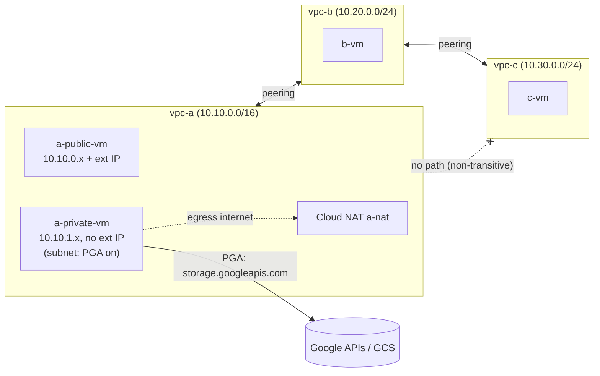

# 01 — VPC from scratch

Build a custom-mode VPC world with Terraform and learn what GCP's network does under the hood.

## Learning goals

- Custom-mode VPC vs auto-mode; subnets are regional, the VPC is global.
- Routes: longest-prefix match first, then priority (lower number wins); routes are global-per-VPC objects.
- Firewall: priority, implied rules, stateful, enforced at the VM vNIC.
- Private Google Access (PGA) vs Cloud NAT vs external IP: three different egress paths.
- VPC peering is **non-transitive** (A↔B, B↔C does not give A↔C).
- Connectivity Tests (static analysis) vs packet captures (ground truth).

## Architecture



## Prerequisites and env vars

Offline: `terraform` >= 1.5, `go` >= 1.22. Cloud steps additionally need `gcloud`, a billing-enabled project, and ADC (`gcloud auth application-default login`).

```bash
export TF_VAR_project_id="your-project-id"   # also: export GCP_PROJECT_ID=$TF_VAR_project_id
export TF_VAR_region="us-central1"           # also: export GCP_REGION=$TF_VAR_region
```

Nothing is hardcoded; no credentials live in this repo.

## Cost estimate (approximate, verify current pricing)

4× e2-micro (~$0.008/h each), Cloud NAT gateway (~$0.0014/h per VM + data), ephemeral external IPs in use (~$0.005/h each), tiny GCS bucket. Roughly **$0.10–0.15/hour** total; a 2-hour session is well under $1. VPCs, subnets, routes, firewall rules and peering are free. Run `scripts/teardown.sh` when done.

## Step by step

Offline (works now):

```bash
cd go && go test ./... && cd ..        # unit tests for the probe
scripts/build.sh                        # tests + cross-compile go/bin/probe (linux/amd64)
cd terraform && terraform fmt -check && terraform init -backend=false && terraform validate
```

Requires GCP:

```bash
cd terraform
terraform init
terraform plan -out tfplan
terraform apply tfplan
terraform output
gcloud compute ssh a-private-vm --zone "$(terraform output -raw zone)" --tunnel-through-iap
```

The startup script downloads the Go probe from the bucket with `gcloud storage cp` (this only works from `a-private-vm` because PGA/NAT is on) and runs `probe serve` on :8080. Test from a VM: `probe check -target <ip>:8080`.
Tip: create a `tmux` pane per VM; you need `sudo apt-get install -y tcpdump` on the VMs (needs NAT on a-private-vm).

## Predict then verify

Write your prediction before opening the answer. All commands require GCP.

**1. a-private-vm → b-vm on :8080. Succeeds?**
<details><summary>Answer</summary>

Yes. Peering exchanges subnet routes, and `b-allow-internal` allows 10.10.0.0/16. Verify:
```bash
gcloud compute routes list --filter="network:vpc-a" --format="table(name,destRange,nextHopPeering,priority)"
probe check -target <b-ip>:8080     # on a-private-vm
```
</details>

**2. a-private-vm → c-vm on :8080. Succeeds?**
<details><summary>Answer</summary>

No (timeout). vpc-a has no route to 10.30.0.0/24: peering routes are not re-exported through B. Verify with the route list above (no 10.30 entry) and the connectivity test:
```bash
gcloud network-management connectivity-tests describe a-private-to-c-expect-fail --format="value(reachabilityDetails.result)"
```
Expect `UNREACHABLE`; the trace shows a drop for "no route".
</details>

**3. Two routes to 203.0.113.0/24 (priority 100 → a-public-vm, 200 → a-private-vm). Which next hop is used from a-private-vm? From a-public-vm?**
<details><summary>Answer</summary>

Lowest priority number wins: a-public-vm (100). Both are tagged `route-demo` so both apply to both VMs. Verify:
```bash
gcloud compute routes list --filter="destRange=203.0.113.0/24" --format="table(name,priority,nextHopInstance)"
gcloud network-management connectivity-tests create route-check --source-instance=projects/$TF_VAR_project_id/zones/$(terraform output -raw zone)/instances/a-private-vm --destination-ip-address=203.0.113.10 --protocol=ICMP --source-network=projects/$TF_VAR_project_id/global/networks/vpc-a
```
(Next hop 100 is shown in the trace. A VM whose own route points at itself is not looped back.)
</details>

**4. With `enable_deny_rule=true` (priority 100 deny vs priority 1000 allow), does a-private→a-public :8080 work?**
<details><summary>Answer</summary>

No. Lower number = higher precedence; deny at 100 beats allow at 1000. Verify: `terraform apply -var enable_deny_rule=true`, then `probe check` fails; `gcloud compute firewall-rules list --filter="network:vpc-a" --format="table(name,priority,denied,allowed)"`.
</details>

**5. Does a-private-vm reach storage.googleapis.com if you disable both PGA and NAT?**
<details><summary>Answer</summary>

No: no external IP and no NAT means no path to Google's public API IPs. Verify: `terraform apply -var enable_pga=false -var enable_nat=false`, then on the VM `curl -sS -m 5 -o /dev/null -w '%{http_code}\n' https://storage.googleapis.com/` times out. Re-enable PGA only and it works (without NAT, general internet still fails).
</details>

**6. What source IP does a peer see from a-private-vm → b-vm?**
<details><summary>Answer</summary>

The VM's internal 10.10.1.x address — no NAT across peering. Verify on b-vm: `sudo tcpdump -ni ens4 tcp port 8080` while running the probe from a-private-vm.
</details>

## Break it on purpose

Each requires GCP; revert with `terraform apply` afterwards.

1. `-var enable_nat=false`: a-private-vm loses general internet but keeps Google APIs (PGA). Check `curl -m5 https://example.com` fails and `curl -m5 -I https://storage.googleapis.com` responds (HTTP 4xx = reachable).
2. `-var enable_pga=false` while NAT stays on: Google API traffic now goes out through NAT (look at NAT logs in Cloud Logging, resource `nat_gateway`).
3. `-var enable_b_c_peering=false`: c-vm becomes isolated; test B→C fails.
4. Delete `a-allow-internal` (`gcloud compute firewall-rules delete a-allow-internal`) — traffic from B to A drops (implied deny ingress). Terraform will recreate it on next apply.
5. Add an egress deny at priority 100 and watch the VM's own outbound traffic die even though the implied egress rule allows by default.

## Under the hood

**How is a VPC implemented?** There are no routers or switches in the data path. Andromeda is Google's software-defined network: a control plane programs the host's virtual switch on each physical machine, which encapsulates VM packets and sends them directly host-to-host. The "VPC" is mostly a configuration scope.

**Where is the firewall enforced?** Distributed, at each VM's vNIC on its host, not at a subnet boundary or central appliance. Hence a rule can block traffic between two VMs in the same subnet, and there is no choke point to scale.

**Implied rules?** Two lowest-priority (65535) rules exist in every VPC: allow all egress, deny all ingress. They cannot be removed (but can be overridden by higher priority rules). Custom-mode VPCs get no default-allow-internal/ssh/icmp rules; that is why this lab creates its own. Rules are stateful (connection tracking), so return traffic is allowed.

**Routes are global-per-VPC?** Routes are objects of the VPC (global); subnet routes are created automatically per subnet, plus a default route (0.0.0.0/0 → default internet gateway) for new VPCs. Selection: longest prefix, then priority, then ECMP. Subnets in different regions can talk without any gateway because every host receives the full table (regional dynamic-routing mode only affects Cloud Router learned routes).

**Why can't a-private-vm reach Google APIs without PGA/NAT?** There is no external IP, so the 1:1 NAT that gives public egress is missing. PGA lets the host stack deliver traffic for Google API VIPs without one; Cloud NAT is a distributed NAT in the same host stack (not a VM or proxy), allocating port ranges per VM.

**Why is peering non-transitive?** Each peering exchanges only that pair's subnet routes into the two VPCs. B has routes for A and C, but A never learns C's routes through B (import/export is not recursive), and peered VPCs do not forward on behalf of a third. Fixes: peer A↔C directly, Network Connectivity Center, or Cloud VPN/proxy VM in B with custom route export.

**Connectivity Tests vs tcpdump?** Connectivity Tests analyze config (routes, firewall, peering) and optionally live data-plane probes; they don't prove an application listens. tcpdump on the VM only shows packets that reach/leave the guest — packets dropped by the vNIC firewall never appear in it. Using both locates where a drop occurs (firewall drops are invisible to the guest on ingress).

**Packet capture recipes (requires GCP):**
```bash
sudo tcpdump -ni ens4 -c 20 'icmp or tcp port 8080'   # on the destination VM
sudo tcpdump -ni ens4 host <peer-ip>                  # check source IP preserved across peering
```
Interface MTU is 1460 by default (`ip link show ens4`); a guest-visible encapsulation hint.

## Teardown

```bash
scripts/teardown.sh   # requires GCP: terraform destroy, then orphan checks (instances, networks, router, addresses, firewalls, bucket)
```

Prints `clean` if nothing remains; otherwise lists orphans and exits 1. Disabled APIs are left enabled (`disable_on_destroy=false`) — no cost.
