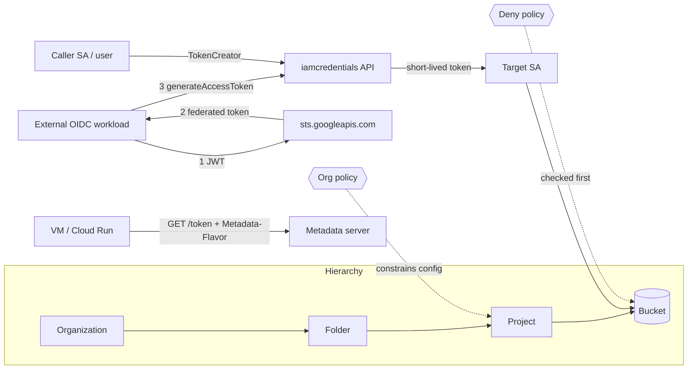

# 02 — IAM Deep Dive

Understand what actually happens when GCP decides "may principal P do action A on resource R?" — and how credentials are minted, exchanged and expired.

## Learning goals
- Resource hierarchy (org → folder → project → resource) and **policy inheritance** (allow policies are a *union* going down).
- **Additive allow policies**: bindings never subtract; only deny policies and org policies restrict.
- **Deny policies**: evaluated before allow, can't be overridden by any grant.
- **IAM Conditions** (CEL on `resource.name`, `request.time`, …).
- **Service account impersonation** (`roles/iam.serviceAccountTokenCreator`) and **short-lived credentials**.
- **Metadata server** token flow (`Metadata-Flavor: Google`).
- **Workload Identity Federation** and the **STS token exchange** (RFC 8693).
- **Org policy constraints** (what resources may *be configured*, vs IAM = who may act).

## Architecture



What Terraform creates (all in one project): 3 service accounts (caller, target, wif), a bucket + object, a *conditional* project-level `objectViewer` grant to target, a bucket-level grant to the WIF SA, `objectAdmin` for caller, TokenCreator (caller→target), a deny policy (caller can't delete objects), an org policy (`iam.disableServiceAccountKeyCreation`), and a WIF pool + OIDC provider with `workloadIdentityUser` for one external subject.

Folders/org-level policy need an organization, so inheritance above the project is covered through reasoning exercises, not resources.

## Prerequisites & env vars
- Terraform >= 1.6, Go >= 1.22, `gcloud` (for lab steps). A GCP project with billing, and permission to manage IAM, deny policies, and org policy on it (e.g. Owner + `roles/iam.denyAdmin` + `roles/orgpolicy.policyAdmin`).

```bash
export TF_VAR_project_id="your-project"      # Terraform
export TF_VAR_region="us-central1"
export GCP_PROJECT_ID="$TF_VAR_project_id"   # used by commands below
export GCP_REGION="$TF_VAR_region"
```
No IDs or credentials are hardcoded. Never commit tfstate (gitignored).

## Cost
Effectively $0: service accounts, IAM, STS, WIF, and policies are free; one tiny bucket with one 32-byte object costs fractions of a cent/month. Destroy when done.

## Run steps
Local, no cloud needed:
```bash
cd go && go vet ./... && go test ./...          # tests fake the three endpoints with httptest
cd ../terraform && terraform fmt -check && terraform init -backend=false && terraform validate
```
**Requires GCP:**
```bash
cd terraform && terraform init && terraform apply
export BUCKET=$(terraform output -raw bucket_name)
export TARGET=$(terraform output -raw target_sa_email)
export CALLER=$(terraform output -raw caller_sa_email)
export WIF_AUDIENCE=$(terraform output -raw wif_audience)
# let YOUR user act as the caller SA (replace with your identity):
gcloud iam service-accounts add-iam-policy-binding "$CALLER" \
  --member="user:YOU@example.com" --role=roles/iam.serviceAccountTokenCreator
cd ../go && go build -o iamtool ./cmd/iamtool

# 1. impersonation chain: user -> caller SA -> target SA (every hop visible on stderr)
export CALLER_TOKEN=$(gcloud auth print-access-token --impersonate-service-account="$CALLER")
./iamtool impersonate "$TARGET"                 # PRINT_TOKEN=1 to get the raw token
export ACCESS_TOKEN=$(PRINT_TOKEN=1 ./iamtool impersonate "$TARGET" 2>/dev/null | tail -1)
./iamtool call-gcs "$BUCKET" hello.txt          # HTTP 200

# 2. Metadata server (run on a GCE VM / Cloud Shell-like env with an attached SA)
./iamtool metadata

# 3. STS exchange: needs a real JWT from the trusted issuer matching oidc_subject
SUBJECT_JWT=... ./iamtool sts
```
Step 3 needs a token from your OIDC issuer; with the default GitHub issuer you'd run it inside a GitHub Actions job (set `oidc_issuer_uri`/`oidc_subject` to your own).

## Predict then verify
Answer before running. Verification steps **require GCP**.

1. `call-gcs` with the target's token on `hello.txt`: allowed? Which binding grants it?
<details><summary>Answer</summary>Yes (200). The project-level conditional `objectViewer` binding: the condition's resource-name prefix matches the bucket and the time bound hasn't passed. Verify: `gcloud projects get-iam-policy $GCP_PROJECT_ID --format=json` and see the `condition` block.</details>

2. Same token, but request an object from a *different* bucket in the project. Result?
<details><summary>Answer</summary>403. The condition on the only grant fails for other buckets; additive policies give no implicit access.</details>

3. Using the caller SA's token, try to delete `hello.txt`. caller has `objectAdmin` — outcome?
<details><summary>Answer</summary>403 with a "denied by policy" message. Deny policy is evaluated before allow, so the objectAdmin grant is irrelevant. Verify: `gcloud iam policies list --kind=denypolicies --attachment-point=cloudresourcemanager.googleapis.com/projects/$GCP_PROJECT_ID` (or console IAM → Deny).</details>

4. `expires_in` from `impersonate`, and what happens if you request a lifetime of 7200s?
<details><summary>Answer</summary>300s here. 7200s is rejected by default (max 3600s) unless the org policy `iam.allowServiceAccountCredentialLifetimeExtension` lists the SA.</details>

5. `gcloud iam service-accounts keys create k.json --iam-account=$TARGET` — result?
<details><summary>Answer</summary>FAILED_PRECONDITION: blocked by org policy constraint `iam.disableServiceAccountKeyCreation`. Org policy restricts configuration even for Owners.</details>

6. In the STS request, what does the returned token represent before any SA impersonation?
<details><summary>Answer</summary>A federated token whose principal is `principal://iam.googleapis.com/<pool>/subject/<sub>`. Because we bound `workloadIdentityUser` and grant the pool principal access, you can call `generateAccessToken` on the WIF SA with it to get an SA token, or use direct resource access if the principal itself is granted.</details>

## Break it on purpose
Each **requires GCP**; revert with `terraform apply`.
1. Remove the `condition` block from the project binding → re-run Predict #2; access now spans every bucket (inheritance + over-broad grant).
2. Delete `google_service_account_iam_member.caller_token_creator` → `impersonate` returns 403 `iam.serviceAccounts.getAccessToken` denied.
3. Delete the `Metadata-Flavor` header in `gcpauth.go` (and run on a VM) → 403 from metadata server; the unit test also fails.
4. Change `oidc_subject` to something else → STS returns `invalid_grant`/attribute condition failure; nothing is exposed.
5. Set `enable_deny_policy=false` → delete now succeeds for caller.
6. Set `lifetimeSeconds` to 7200 → rejected (see #4 above).

## Under the hood
<details><summary>How does GCP evaluate an access request?</summary>
Principal Access Boundary (if any) and deny policies first; if any deny matches → DENY. Then allow policies are collected from the resource and all ancestors, unioned, and conditions evaluated; any matching binding → ALLOW. Otherwise DENY. Org policy is separate: it gates API operations that create/configure resources.</details>

<details><summary>Why is there no "remove access" at a child level?</summary>
Allow policies are additive on a hierarchy path. The only ways to carve out are deny policies, conditions on the parent grant, or not granting at the parent.</details>

<details><summary>What does the metadata server do with a token request?</summary>
`GET /computeMetadata/v1/instance/service-accounts/default/token` at 169.254.169.254 (metadata.google.internal). The `Metadata-Flavor: Google` header proves the request isn't a browser/SSRF forward (browsers can't add it cross-origin; `X-Forwarded-For` requests are rejected). Google backends mint a token for the attached SA; it's cached and refreshed ~5 min before its ~1 hour expiry.</details>

<details><summary>What does generateAccessToken verify?</summary>
The caller's token must carry `iam.serviceAccounts.getAccessToken` on the target (from TokenCreator). The response holds a bearer token with `expireTime`; audit logs record both the caller and the target. Chains (`delegates`) require TokenCreator at each hop.</details>

<details><summary>How does WIF avoid long-lived keys?</summary>
The workload presents a JWT signed by its own IdP. STS validates the signature (via the issuer's JWKS), maps claims via `attribute_mapping`, enforces `attribute_condition`, and returns a short-lived federated token. The trust anchor is configuration, not a secret.</details>

<details><summary>Why `attribute_condition` matters?</summary>
Without it, any token from a shared issuer (e.g. any GitHub repo) could authenticate to your pool. Always restrict to specific subject/repo claims.</details>

## Teardown
**Requires GCP:** `./scripts/teardown.sh` (runs `terraform destroy`; needs TF_VAR_project_id and TF_VAR_region). Also remove the manual TokenCreator binding you added to the caller SA — it is deleted with the SA. WIF pools are soft-deleted for 30 days.
