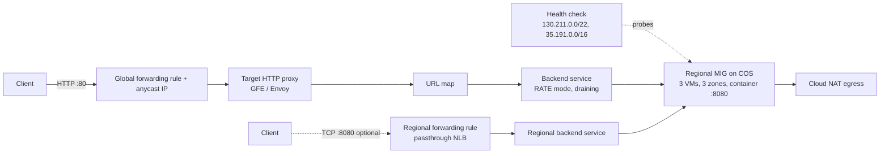

# 03 – Load Balancing Anatomy

Take a Google Cloud global external Application Load Balancer apart, piece by piece, and compare it with an L4 passthrough Network Load Balancer over the same backends.

## Learning goals

- Name every object in the global external Application LB chain: forwarding rule → target HTTP proxy → URL map → backend service → instance-group backends (+ health check).
- Explain what Google Front Ends (GFEs) and Envoy do, and why the backend sees the GFE, not the client.
- Contrast L7 proxy LB (terminated connection, new connection to backend, `X-Forwarded-For`/`Via`) with L4 passthrough (client IP preserved, no proxy).
- Know the health-check probe ranges (`130.211.0.0/22`, `35.191.0.0/16`) and why the firewall must allow them.
- Understand balancing modes (RATE / UTILIZATION), `max_rate_per_instance`, and `capacity_scaler`.
- See connection draining in action.

## Architecture



## Layout

- `go/` – stdlib backend (`/`, `/healthz`, `/healthz/fail`, `/healthz/ok`, `/slow?s=N`), tests, distroless Dockerfile.
- `terraform/` – all infrastructure (google provider `~> 6.10`).
- `scripts/teardown.sh` – destroy + orphan checks.

## Prerequisites and env vars

- Terraform ≥ 1.5, Go ≥ 1.22, Docker, `gcloud` (authenticated: `gcloud auth application-default login`).
- A GCP project with billing enabled.

```bash
export GCP_PROJECT_ID=my-project
export GCP_REGION=us-central1
export TF_VAR_project_id="$GCP_PROJECT_ID"
export TF_VAR_region="$GCP_REGION"
```

No IDs or credentials are hardcoded anywhere.

## Cost

Roughly: 3× e2-small (~$0.02/h each), Cloud NAT (~$0.045/h + data), global forwarding rule (~$0.025/h), optional NLB forwarding rule (~$0.025/h). About **$0.15–0.20/hour**; a two-hour session is well under $1. Tear down when finished.

## Run steps

### Local (no GCP needed)

```bash
cd go && gofmt -l . && go vet ./... && go test ./...
PORT=8080 go run . &   # then: curl localhost:8080/ ; curl localhost:8080/healthz/fail
```

### Terraform static checks (no GCP needed)

```bash
cd terraform && terraform fmt -check && terraform init -backend=false && terraform validate
```

### Deploy (requires GCP)

1. Create registry + base infra first, so you can push the image (requires GCP):
   ```bash
   cd terraform && terraform init
   terraform apply -target=google_artifact_registry_repository.repo
   ```
2. Build and push (requires GCP):
   ```bash
   REPO=$(terraform output -raw registry_repo)
   gcloud auth configure-docker "${GCP_REGION}-docker.pkg.dev"
   docker build --platform linux/amd64 -t "$REPO/lbdemo:latest" ../go && docker push "$REPO/lbdemo:latest"
   ```
3. Apply everything (requires GCP): `terraform apply` (add `-var enable_network_lb=true` for the L4 comparison).
4. Wait ~3–5 min for VMs to pull the image and pass health checks, then (requires GCP):
   ```bash
   LB=$(terraform output -raw lb_ip); curl -i http://$LB/
   ```

## Predict then verify

Each requires GCP. Write your guess down first.

**1. Which source IP does the app see in `remote_addr` via the global LB?**
<details><summary>Answer</summary>A Google proxy address in `130.211.0.0/22` or `35.191.0.0/16`, not your IP. Your IP is in `X-Forwarded-For`.</details>

**2. What does `X-Forwarded-For` contain?**
<details><summary>Answer</summary><code>&lt;client-ip&gt;,&lt;LB-IP&gt;</code>. The client IP, then the LB's forwarding-rule IP appended by the proxy. `Via: 1.1 google` is also added.</details>

**3. `curl http://$LB/` 20 times; how are requests distributed across the 3 VMs?**
<details><summary>Answer</summary>Roughly even, but not strict round-robin: the LB prefers backends in the zone/proxy closest to the traffic and spreads by capacity. With low rate, well below `max_rate_per_instance`, expect uneven but all-three coverage.</details>

**4. With `enable_network_lb=true`, what is `remote_addr` via the NLB (`:8080`)?**
<details><summary>Answer</summary>Your real client IP. Passthrough LBs don't terminate the connection; there are no XFF/Via headers either.</details>

**5. After `curl $NLB:8080/healthz/fail`-ing one VM (via IAP SSH or through the LB until you hit it), what happens within ~15 s?**
<details><summary>Answer</summary>The health check marks it UNHEALTHY after 2 failed probes (5 s interval) and it stops receiving new requests; MIG autohealing eventually recreates it after the initial delay if it stays unhealthy.</details>

**6. Set `balancing_mode=UTILIZATION` and apply. What changes in the backend?**
<details><summary>Answer</summary>`max_rate_per_instance` is replaced by `max_utilization` (CPU-based); in-place update of the backend service, no VM changes.</details>

## Break it on purpose

Each requires GCP.

1. **Remove the health-check firewall rule** (`terraform destroy -target=google_compute_firewall.lb_and_probes`). Expect all backends UNHEALTHY and `502` from the LB. Re-apply to fix.
2. **Fail one backend**: from a VM run `curl localhost:8080/healthz/fail`. Watch `gcloud compute backend-services get-health lbanat-be --global`. Restore with `/healthz/ok`.
3. **Fail all backends**: LB returns 502 ("failed_to_pick_backend"). Check the LB logs in Logging.
4. **Drain**: `terraform apply -var capacity_scaler=0` and watch traffic leave while in-flight requests finish.
5. **Connection draining**: start `curl http://$LB/slow?s=25`, then delete the instance serving it (`gcloud compute instances delete`, or MIG rolling replace). The request completes if within `draining_timeout_sec` (30); set `-var draining_timeout_sec=0` and repeat to see it cut.
6. **Tiny rate limit**: `-var max_rate_per_instance=1`, then hammer with `hey`/`ab`. Observe capacity exhaustion (429/503 once all backends are over capacity and the LB spills over).
7. **Timeout**: `curl http://$LB/slow?s=40` exceeds the 30 s backend `timeout_sec` → `502`/`504` from the LB.

## Under the hood

**Q: Where does the "load balancer" actually run?**
A: There is no VM. For global external Application LB, the forwarding rule's anycast IP is advertised from Google's edge; GFEs (Envoy-based for the `EXTERNAL_MANAGED` scheme) terminate the client connection and open a fresh one to your backend.

**Q: Why two probe ranges?**
A: `130.211.0.0/22` and `35.191.0.0/16` are the sources of health-check probers and of proxied LB traffic to backends. The firewall rule here allows exactly those on the app port; VPC default-deny ingress otherwise blocks them.

**Q: RATE vs UTILIZATION?**
A: RATE caps requests/sec per instance (`max_rate_per_instance`) and suits stateless HTTP. UTILIZATION targets backend CPU. `CONNECTION` is for L4 and is used by the NLB here. `capacity_scaler` scales the configured capacity; 0 drains.

**Q: Why does the NLB need a firewall rule for `0.0.0.0/0`?**
A: Passthrough preserves the client source IP, so the packet reaching the VM comes from the client, not a Google range.

**Q: Is the NLB a proxy?**
A: No: Maglev-style forwarding delivers packets to the VM with the VIP; the VM answers directly (direct server return).

**Q: What is connection draining?**
A: When a backend is removed or marked for removal, existing connections get up to the timeout to finish while new ones go elsewhere.

## Teardown

```bash
./scripts/teardown.sh   # requires GCP; runs terraform destroy then checks for orphans
```
