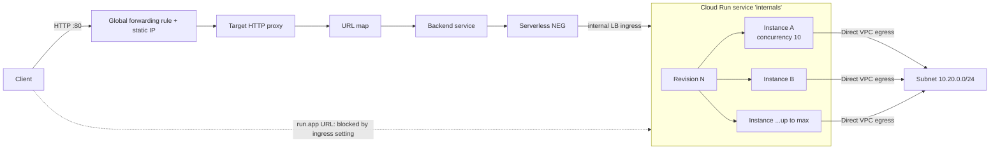

# 04 — Cloud Run internals

Cloud Run is "just a container behind HTTPS", but the behaviour that matters (when instances appear, how many requests share one, what you pay for, how traffic reaches it) lives in rules you can observe and bend. This project builds one service, instruments it, and lets you poke at those rules.

## Learning goals

- Revision vs. instance model: a *revision* is an immutable config snapshot; *instances* are the running containers of a revision.
- Request concurrency and how it drives autoscaling.
- Cold starts, startup CPU boost, startup probes.
- CPU allocation modes: request-based (throttled between requests) vs. instance-based (always on).
- Min/max instances: warm pool vs. hard cap.
- Direct VPC egress (instance gets a subnet IP; no connector VMs).
- Serving through the global external LB with a serverless NEG; ingress settings.
- Container contract: listen on `$PORT`, SIGTERM then ~10 s grace, then SIGKILL.

## Architecture



Go workload (`go/`): `/info` (instance ID, in-flight count, uptime, `cold_start` = first request served by this instance), `/work?cpu_ms=&latency_ms=` (burn CPU, then sleep), `/healthz`. SIGTERM is logged with a `SIGTERM-HANDLER:` prefix and the server drains gracefully. `STARTUP_DELAY` env var (set via the Terraform `startup_delay` variable) fakes a slow boot. `go/cmd/loadgen` is a concurrent load generator that reports distinct instances, cold starts and latency percentiles.

## Prerequisites and environment variables

- Local-only (no GCP): Go ≥ 1.22, Terraform ≥ 1.6.
- Requires GCP: a project with billing, `gcloud` authenticated (`gcloud auth application-default login`), Docker.

```bash
export GCP_PROJECT_ID=your-project-id
export GCP_REGION=us-central1
export TF_VAR_project_id="$GCP_PROJECT_ID"
export TF_VAR_region="$GCP_REGION"
```

No IDs or credentials are stored in the repo.

## Cost

Scale-to-zero Cloud Run is near free at demo volumes (free tier covers light use). The costs that persist are the **global forwarding rule (~$18/month, i.e. ~$0.025/h)** and the static IP while the LB exists, plus any `min_instances` > 0. A few hours of experiments is typically well under a few dollars. Run teardown when done. Prices vary; check the current pricing page.

## Run steps

### 1. Local, no GCP

```bash
cd go
go vet ./... && go test ./...
PORT=8080 go run ./cmd/service &          # then: curl localhost:8080/info
go run ./cmd/loadgen -url 'http://localhost:8080/work?latency_ms=300' -c 20 -d 5s
kill -TERM %1                              # watch the SIGTERM-HANDLER log lines
```

Terraform checks (no GCP access needed):

```bash
cd terraform && terraform fmt -check && terraform init -backend=false && terraform validate
```

### 2. Deploy (requires GCP)

```bash
cd terraform
terraform init
terraform apply                      # first apply uses Google's hello image
REPO=$(terraform output -raw image_repo)
gcloud auth configure-docker "$GCP_REGION-docker.pkg.dev"
docker build --platform linux/amd64 -t "$REPO/svc:v1" ../go
docker push "$REPO/svc:v1"
terraform apply -var "image=$REPO/svc:v1"    # creates revision 2 with the Go image
LB=$(terraform output -raw lb_ip)
curl "http://$LB/info"               # LB can take a few minutes after creation
```

### 3. Observe autoscaling (requires GCP)

```bash
cd ../go
go run ./cmd/loadgen -url "http://$LB/work?latency_ms=1000" -c 40 -d 60s
```

Compare `distinct_instances` with your prediction. Also watch Cloud Run's "Container instance count" metric in the console.

## Predict then verify

Write your answer *before* running. Defaults: concurrency 10, max 5, min 0, request-based CPU.

1. With `-c 40` and 1 s requests, roughly how many instances will you see, and why?
<details><summary>Expected</summary>

5 (the max). Demand is 40 in-flight requests / 10 concurrency = 4 instances at 100% utilisation, but the autoscaler targets about 60% concurrency utilisation, so it wants ~7, and the cap clips it at 5. The cap's capacity is 5×10=50 ≥ 40, so requests still fit, but latency rises while instances start. Raise `max_instances` to see more.
</details>

2. What fraction of requests report `cold_start: true` on a service that has been idle for an hour?
<details><summary>Expected</summary>

Exactly one per newly started instance. After a quiet period you have 0 instances; a burst creates N instances and so N cold-start responses, a small fraction of total requests. Requests that arrive while an instance boots wait for it.
</details>

3. Set `concurrency=1` and rerun `-c 20`. What changes?
<details><summary>Expected</summary>

Each instance handles one request at a time, so you hit `max_instances` (5) quickly; with 20 concurrent clients, only 5 can be served at once, the rest queue (for up to the request timeout or until capacity), so p95 latency climbs. `inflight` in responses is always 1. Cost per request rises because instances are not shared.
</details>

4. `curl http://$LB/info` repeatedly with no load: does `uptime_seconds` keep growing between calls, and does it always return the same `instance_id`?
<details><summary>Expected</summary>

Typically same ID while the instance remains alive (uptime grows). After ~15 minutes idle (not guaranteed) the instance is reclaimed and the next call shows a new ID, `cold_start: true` and low uptime. With `min_instances=1` the ID stays stable.
</details>

5. Which URL works with the default ingress: the `run_url` or the LB IP?
<details><summary>Expected</summary>

Only the LB IP. `INGRESS_TRAFFIC_INTERNAL_LOAD_BALANCER` rejects direct `run.app` traffic from the internet (403/404 from Google's frontend) even though `allUsers` has invoker.
</details>

## Break it on purpose

Each is a variable change plus `terraform apply` (requires GCP). Predict, then observe.

1. **Slow start:** `-var startup_delay=5s -var startup_cpu_boost=false`. Compare cold-start latency with boost on. Check logs for `slow startup`. (Note: the boost only speeds up CPU-bound startup; a `sleep` is unaffected, so use real init work to see a difference.)
2. **CPU throttling:** add background CPU work after a response (e.g., a goroutine ticking) and compare `cpu_always_allocated=false` vs `true`. In request-based mode, CPU is throttled outside requests, so background work stalls.
3. **Warm pool:** `-var min_instances=1`, then idle for 20 minutes. No cold start, but you pay idle rate for the instance.
4. **Open the front door:** `-var ingress=INGRESS_TRAFFIC_ALL` then `curl $(terraform output -raw run_url)/info` now succeeds, bypassing the LB.
5. **Break the contract:** hardcode port 9999 in `main.go`, rebuild, push, apply. The revision fails its startup probe (port 8080) and never becomes ready; traffic stays on the previous revision. Read the error in `gcloud run revisions describe`.
6. **Ignore SIGTERM:** remove the handler, deploy a new revision under load. Rollouts cut connections after the grace period. With the handler, logs show `SIGTERM-HANDLER:` lines and in-flight requests finish.

## Under the hood

**Q: Revision vs. instance?**
A revision is an immutable snapshot (image, env, CPU, concurrency, scaling, VPC). Any template change creates a new one; traffic is split between revisions. Instances are ephemeral container sandboxes created from a revision; you never address them directly.

**Q: How does autoscaling decide?**
Instance count follows in-flight requests relative to `concurrency` (targeting roughly 60% utilisation), CPU utilisation (also ~60% target), clamped to min/max. Requests that can't be placed wait in a queue while new instances start.

**Q: What is a cold start made of?**
Placing the sandbox, pulling/streaming the image, starting the container, then your app init until the startup probe passes. Startup CPU boost gives extra CPU only during startup (helps JVM/Node-style init). Smaller images and lazy init help; `min_instances` avoids it for steady traffic.

**Q: Request-based vs. instance-based CPU?**
Request-based (`cpu_idle=true`): CPU is available only while handling requests (and during startup/shutdown), billed per request-time. Instance-based: CPU is always on for the instance's lifetime; needed for background work, and cheaper at high sustained load. In Terraform the field is `cpu_idle`, the inverse of "always allocated".

**Q: Why Direct VPC egress instead of a connector?**
Instances get IPs straight from your subnet, so there are no connector VMs to pay for or size, and lower latency. Each instance consumes an IP, so size the subnet for max instances (plus headroom). `PRIVATE_RANGES_ONLY` sends only RFC1918 traffic through the VPC.

**Q: What is a serverless NEG?**
A backend of the LB that points at a Cloud Run service rather than VMs. The LB gives you a static anycast IP, Cloud Armor, CDN, custom domains and multi-region routing. The LB does not choose instances; Cloud Run does.

**Q: Why does `allUsers` appear alongside an "internal" ingress?**
Ingress limits *where* traffic may come from (network path); IAM limits *who*. The LB doesn't present a Google identity to Cloud Run, so IAM must allow it; the ingress setting is what stops the public URL.

**Q: What does the SIGTERM contract guarantee?**
On shutdown, the container gets SIGTERM, then SIGKILL after about 10 s. Stop accepting, finish in-flight work, exit. The demo uses an 8 s drain deadline for margin.

## Teardown (requires GCP)

```bash
./scripts/teardown.sh        # terraform destroy; needs TF_VAR_project_id / TF_VAR_region
```

APIs are left enabled (`disable_on_destroy=false`). The Artifact Registry repo and its images are destroyed with the stack. Afterwards check `gcloud compute forwarding-rules list --global` is empty.
