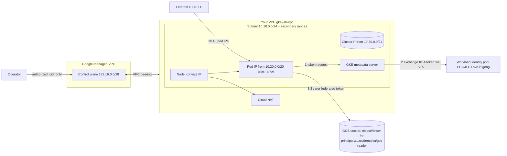

# 05 — GKE Networking & Identity Under the Hood

Terraform builds a **private, VPC-native, Dataplane V2 zonal GKE Standard cluster** with **Workload Identity Federation for GKE**; a small Go service shows what the pod network and the metadata server actually do.

## Learning goals

- **VPC-native / alias IPs**: pods get real VPC-routable IPs from a subnet *secondary range*; each node is handed a /24 alias range.
- **Dataplane V2** (eBPF/Cilium) vs kube-proxy/iptables, and native NetworkPolicy enforcement.
- **Services**: ClusterIP is a virtual IP programmed in the dataplane, not a real interface; **NEG-backed (container-native) Ingress** targets pod IPs directly.
- **Private clusters**: private nodes, control plane in a Google-managed VPC peered to yours, **authorized networks**.
- **Workload Identity Federation for GKE**: `principal://` IAM bindings directly on a KSA (no GSA), and the **GKE metadata server** that intercepts `169.254.169.254`.
- **Autopilot vs Standard** trade-offs.

## Architecture



## Prerequisites & environment variables

Tools: `terraform >= 1.5`, `go >= 1.22`, and (cloud steps) `gcloud`, `kubectl`, `gke-gcloud-auth-plugin`, Docker, an Artifact Registry repo.

```bash
export TF_VAR_project_id="your-project-id"     # also use as GCP_PROJECT_ID
export TF_VAR_region="us-central1"             # also use as GCP_REGION
export GCP_PROJECT_ID="$TF_VAR_project_id" GCP_REGION="$TF_VAR_region"
```
Nothing is hardcoded; no credentials live in the repo. Authenticate with `gcloud auth application-default login`.

## ⚠️ Cost warning

GKE is **not free**: cluster management fee (one zonal cluster per billing account is covered by the free tier credit), `e2-medium` node(s), Cloud NAT, and an external load balancer once you apply the Ingress. The Autopilot cluster (`create_autopilot=true`) bills per pod resource plus the management fee — leave it off unless doing that exercise. **Tear down when finished.**

## Run steps

Local (no GCP needed):
```bash
cd go && go vet ./... && go test ./...
cd ../terraform && terraform fmt -check && terraform init -backend=false && terraform validate
```

*Requires GCP:*
```bash
cd terraform
export TF_VAR_authorized_cidr="$(curl -s ifconfig.me)/32"   # your IP for the control plane
terraform init && terraform apply
$(terraform output -raw get_credentials)

# build & push image (requires GCP)
export IMAGE="$GCP_REGION-docker.pkg.dev/$GCP_PROJECT_ID/REPO/gke-lab:v1"   # REPO = your Artifact Registry repo
(cd ../go && docker build -t "$IMAGE" . && docker push "$IMAGE")
export BUCKET="$(terraform output -raw bucket)"

cd ..
kubectl apply -f k8s/namespace-ksa.yaml
envsubst < k8s/deployment.yaml | kubectl apply -f -
kubectl apply -f k8s/service-ingress.yaml
kubectl -n demo port-forward deploy/app 8080:8080 &
curl localhost:8080/          # pod IP / node
curl localhost:8080/metadata  # GKE metadata server answers
curl localhost:8080/gcs       # token flow + GCS call
```
Note: private nodes pull from Artifact Registry through Private Google Access (enabled on the subnet) or via Cloud NAT.

## Predict then verify

Write your prediction first, then check (all *requires GCP*).

1. Run `kubectl -n demo get pods -o wide` and `gcloud container clusters describe gke-lab-standard --zone $TF_VAR_region-b --format='value(ipAllocationPolicy.clusterSecondaryRangeName)'`. **Which CIDR will the pod IPs fall in?**
<details><summary>Answer</summary>The `pods` secondary range 10.20.0.0/20. Each node owns a /24 slice of it, so both pods on one node share a 10.20.x.0/24 prefix.</details>

2. `kubectl -n demo get svc app`. **Is the ClusterIP inside the node subnet, pod range, or elsewhere? Can you ping it from a node?**
<details><summary>Answer</summary>Inside the services range 10.30.0.0/24. It isn't assigned to any interface; Dataplane V2 (eBPF) translates it to a pod IP at connect time, so ICMP ping gets no reply while TCP to the service port works.</details>

3. `/gcs` returns 200 with the KSA-only binding. **What does `/metadata` report for `sa_email`?**
<details><summary>Answer</summary>Under WIF with direct principal binding there's no Google service account; the email endpoint typically returns `default` or an empty/placeholder value (exact output varies by GKE version) — identity is the federated principal, not an SA.</details>

4. After applying `k8s/networkpolicy.yaml`, **can a pod without `role=client` curl `app`?**
<details><summary>Answer</summary>No — it times out (dropped, not refused). `kubectl -n demo run c --rm -it --labels role=client --image=curlimages/curl -- curl -m3 app` succeeds.</details>

5. **Does `kubectl` work from a machine outside `authorized_cidr`?**
<details><summary>Answer</summary>No: the public endpoint exists (private endpoint disabled) but the connection times out/403s because the source IP isn't authorized.</details>

## Break it on purpose

1. **Shrink the pod range** (`10.20.0.0/20` → `/24`) and scale the node pool: new nodes fail to get alias ranges (IP exhaustion). Why? Each node reserves a /24 (110 pods max).
2. **Remove the IAM binding** (`terraform destroy -target=google_storage_bucket_iam_member.ksa_reader`): `/gcs` returns `gcs_status` 403 while the token is still issued — authN works, authZ fails.
3. **Change the KSA name** in the Deployment: the principal subject no longer matches; 403.
4. **Set `workload_metadata_config.mode = "GCE_METADATA"`** on the node pool (requires GCP): pods now get the *node* identity — a privilege leak WI exists to prevent.
5. **Delete the Cloud NAT**: pulls from public registries (e.g. `curlimages/curl`) fail with `ImagePullBackOff` on private nodes.
6. **Apply the default-deny policy without the LB range allow rule**: Ingress health checks fail and the backend goes UNHEALTHY.

## Under the hood

**Why do pods have routable IPs without overlay encapsulation?**
Alias IP ranges: the VPC's SDN knows the node's /24 pod slice as an alias of the node NIC, so routing/anti-spoofing is done by Andromeda with no tunnel.

**What does Dataplane V2 change?**
Cilium eBPF programs on each node implement Service load-balancing and NetworkPolicy instead of kube-proxy iptables chains; no O(n) rule traversal, built-in policy logging, identity-based policy.

**Why NEG-backed Ingress?**
The external LB sends traffic straight to pod IP:port (possible thanks to alias IPs), skipping the node hop (`kube-proxy` second hop / NodePort) and giving accurate health checks and lower latency.

**How does a private cluster's control plane talk to nodes?**
The control plane lives in a Google-owned VPC peered with yours (`172.16.0.0/28`). Peering routes are exchanged, so API server ↔ kubelet/webhooks use private IPs. Authorized networks only filter who may reach the *public* endpoint.

**What happens during a WI token request?**
The pod calls 169.254.169.254; GKE metadata server (a DaemonSet intercepting that address) identifies the calling pod, mints a KSA token for audience `PROJECT.svc.id.goog`, exchanges it through Security Token Service for a federated access token, and returns it. IAM evaluates the `principal://…/subject/ns/NS/sa/KSA` member.

**Autopilot vs Standard?**
Autopilot: Google manages nodes, enforces hardening (Dataplane V2, WI, private-capable, no SSH/privileged pods), bills per pod requests. Standard: you size/patch node pools, can use privileged workloads, DaemonSets freely, and pay for nodes whether full or not. Use `create_autopilot=true` and compare `kubectl get nodes` and pod resource defaults.

**Why is NetworkPolicy enforced with no add-on?**
Dataplane V2 includes the policy engine; on legacy dataplane you'd enable Calico.

## Teardown

*Requires GCP.*
```bash
./scripts/teardown.sh
```
It deletes the Ingress/Service first (so the controller removes forwarding rules and NEGs), then runs `terraform destroy`. Confirm with `gcloud container clusters list` and `gcloud compute forwarding-rules list`.
