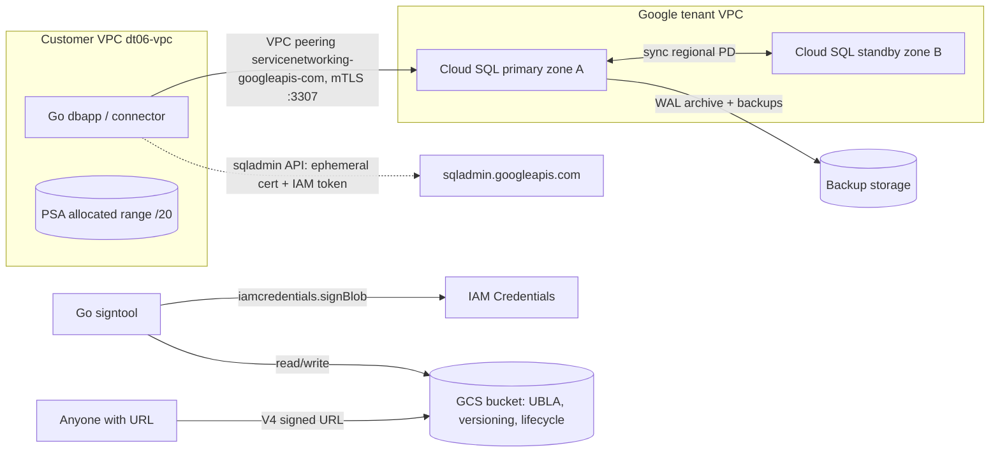

# 06 – Data tier: Cloud SQL & Cloud Storage under the hood

## Learning goals
- Explain how a **private-IP Cloud SQL** instance really works: Private Services Access (PSA) = allocated range + `servicenetworking` VPC peering to a Google-managed tenant VPC.
- Explain **HA (REGIONAL)** failover: synchronous regional disk replication, standby, same IP after failover.
- Use **IAM database authentication** (no password) via the **Cloud SQL Go connector** (same mechanism as the Auth Proxy).
- Understand **backups vs PITR** (daily snapshot + continuous WAL archive).
- Cloud Storage: **strong consistency**, **V4 signed URLs** via IAM `signBlob`, **storage classes & lifecycle**, **uniform bucket-level access**, **versioning/retention**.

## Architecture


## Prerequisites
- A GCP project with billing, `gcloud`, Terraform >= 1.5, Go >= 1.26, Docker (optional).
- Auth: `gcloud auth application-default login`. To run the Go tools locally as the app SA, set `TF_VAR_impersonator_member="user:you@example.com"` and use ADC impersonation (`gcloud auth application-default login --impersonate-service-account=<sa>`). The DB app must also reach the **private** IP, so run it from a VM/Cloud Shell-in-VPC/Cloud Run with VPC access in `dt06-vpc` (requires GCP).

Environment variables (no IDs or credentials live in files):

| Var | Use |
|---|---|
| `TF_VAR_project_id` / `GCP_PROJECT_ID` | project (set both to same value) |
| `TF_VAR_region` / `GCP_REGION` | region |
| `INSTANCE_CONNECTION_NAME`, `DB_USER`, `DB_NAME` | dbapp (from terraform outputs) |
| `BUCKET`, `SIGNER_SA` | signtool (from terraform outputs) |

## ⚠️ Cost warning
A REGIONAL `db-custom-1-3840` instance with SSD is roughly **$100+/month (~$0.15–0.20/hr)**, plus the bucket and backups. **Tear down when finished.** Set `TF_VAR_ha_enabled=false` to halve the cost (but you lose the HA lessons).

## Local checks (no GCP needed)
```bash
cd terraform && terraform fmt -check && terraform init -backend=false && terraform validate
cd ../go && go test ./...
docker build -t dt06 .     # optional
```

## Run steps (requires GCP)
```bash
export TF_VAR_project_id=... TF_VAR_region=us-central1
export GCP_PROJECT_ID=$TF_VAR_project_id GCP_REGION=$TF_VAR_region
cd terraform && terraform init && terraform apply     # ~10-15 min; PSA + HA instance are slow
export INSTANCE_CONNECTION_NAME=$(terraform output -raw instance_connection_name)
export DB_USER=$(terraform output -raw db_user) DB_NAME=$(terraform output -raw db_name)
export BUCKET=$(terraform output -raw bucket) SIGNER_SA=$(terraform output -raw app_service_account)
cd ../go
go run ./cmd/signtool     # requires GCP (signBlob + GCS)
go run ./cmd/dbapp        # requires GCP, run from inside the VPC as the app SA
```
Inspect the hidden pieces:
```bash
gcloud compute addresses list --global --filter=purpose=VPC_PEERING
gcloud services vpc-peerings list --network=dt06-vpc
gcloud compute networks peerings list
```

## Predict then verify
1. **`gcloud compute networks peerings list` – what peering do you expect, and did you create it explicitly?**
   <details><summary>Answer</summary>`servicenetworking-googleapis-com`, created by `google_service_networking_connection`; it peers to Google's tenant VPC, which hosts the Cloud SQL VM. Peering is non-transitive, so on-prem/other VPCs can't reach the DB without extra work (e.g. proxy/VM, custom route export).</details>
2. **After `dbapp` runs, what is `current_user` and does `pg_is_in_recovery()` return true?**
   <details><summary>Answer</summary>`dt06-app@<project>.iam` (SA email minus `.gserviceaccount.com`); `false` – you're on the primary, the standby isn't connectable.</details>
3. **`signtool`: after overwriting an object, can the next read return v1?**
   <details><summary>Answer</summary>No. GCS is strongly consistent for object reads, overwrites, deletes and listing. The anonymous signed-URL GET returns `v2`.</details>
4. **Which API call produces the signature, and which IAM role allows it?**
   <details><summary>Answer</summary>`iamcredentials.googleapis.com` `signBlob`; needs `roles/iam.serviceAccountTokenCreator` on the signing SA (granted to itself here). No private key is ever downloaded.</details>
5. **Trigger failover (`gcloud sql instances failover <instance>`) – does the connection string change?**
   <details><summary>Answer</summary>No: same private IP and connection name. Existing connections drop (~60s typical), the standby zone becomes primary, and the old primary becomes the new standby. The connector reconnects on retry.</details>
6. **An object is 40 days old. What storage class?**
   <details><summary>Answer</summary>NEARLINE (rule at 30 days; COLDLINE at 90). Lifecycle is evaluated asynchronously (~daily), so not instant. Transitions don't change object name or latency materially, but add minimum storage durations/retrieval fees.</details>

## Break it on purpose
1. **Remove the `cloudsql.instanceUser` grant** (`terraform apply -target` after commenting it, or remove in console): `dbapp` fails with an IAM auth error (`FATAL: Cloud SQL IAM user authentication failed`). Restore it.
2. **Run `dbapp` from your laptop**: times out/refuses; there is no route to the PSA range. Private IP means VPC-only.
3. **Delete the allocated-range / peering** (console) then try to create a second instance: fails with a network-connection error.
4. **Try `gcloud storage objects update ... --predefined-acl=publicRead`**: fails because UBLA is on and public access prevention is enforced.
5. **Set `TF_VAR_retention_days=1`, upload, try to delete the object**: denied until retention expires. (Policy is left unlocked; locking is irreversible.)
6. **Overwrite an object, then `gcloud storage ls -a gs://$BUCKET/demo/`**: the old generation is kept (versioning) and later deleted 7 days after becoming noncurrent.
7. **Change `expiry` in signtool to 8 days**: the unit test/validation rejects it (V4 max is 7 days). Remove `tokenCreator` from the SA and signing fails with 403.
8. **`terraform destroy` without disabling deletion protection**: fails – see teardown.

## Under the hood
<details><summary>Why does private IP need a peering and an allocated range?</summary>Cloud SQL VMs run in a Google-owned producer VPC. PSA reserves a CIDR in your VPC (so addresses never overlap with your subnets) and peers the two networks; the instance gets an IP from that range.</details>

<details><summary>How does HA failover work?</summary>The primary writes to a regional persistent disk, synchronously replicated across two zones. A heartbeat monitors the primary; on failure (or manual failover) the standby VM in another zone attaches the disk, replays WAL, and takes over the same IP. This is not a read replica – the standby serves no traffic. Read replicas are separate async instances.</details>

<details><summary>How does IAM DB auth avoid passwords?</summary>The connector gets an OAuth2 access token (scope `sqlservice.login`) for the SA and sends it as the Postgres password. Cloud SQL validates the token and requires `cloudsql.instanceUser`. It's short-lived and refreshed by the connector. The server needs flag `cloudsql.iam_authentication=on`.</details>

<details><summary>What do the connector / Auth Proxy actually do?</summary>They call the sqladmin API (needs `cloudsql.client`) to fetch instance metadata and a short-lived ephemeral client certificate, then open a mutually authenticated TLS connection to port 3307 on the instance IP. Authorization comes from IAM, not IP allowlists; certs are refreshed in the background.</details>

<details><summary>Backups vs PITR?</summary>Automated backups are daily snapshots. PITR additionally archives write-ahead logs continuously (retained here 7 days); a restore (always into a *new* instance via clone) replays logs up to a chosen timestamp.</details>

<details><summary>How is a V4 signed URL verified?</summary>You build a canonical request (method, path, sorted headers/query, expiry) and sign its hash; GCS recomputes the same string and checks the signature against the account's keys. With `signBlob`, IAM signs using Google-managed keys – you never hold a key. Anyone with the URL has the access of the signer until it expires (max 7 days), so keep expiries short.</details>

<details><summary>UBLA vs ACLs?</summary>Uniform bucket-level access disables object ACLs so that IAM is the single control plane. Easier to audit; required for some features (e.g. managed folders). Can be reverted only within 90 days of enabling.</details>

<details><summary>Versioning vs retention?</summary>Versioning keeps overwritten/deleted objects as noncurrent generations (recoverable, billed). A retention policy prevents deletion/overwrite of any object until its age exceeds the period; locking makes it permanent. Object holds are separate.</details>

## Teardown
```bash
./scripts/teardown.sh      # requires GCP
```
It (1) turns off Cloud SQL **deletion protection** via a targeted apply, (2) destroys with the order instance → PSA connection → allocated range → VPC (the peering is "in use" until the instance is gone; the connection uses `deletion_policy = "ABANDON"` to avoid the well-known "Producer services are still using this connection" error), then (3) lists leftovers. Instance names are reserved for about a week; this project uses a random suffix.
