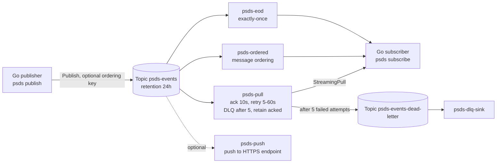

# 07 — Pub/Sub Delivery Semantics

> **Status: NOT verified against real GCP.** Terraform passes `fmt`/`validate` and the Go pure logic is unit-tested, but none of the cloud behaviors described here (redelivery timing, DLQ, ordering, exactly-once, seek) have been run against a real project. Treat expected outputs as predictions, and report discrepancies.

## Learning goals

- Why Pub/Sub is **at-least-once**, and how duplicates arise (ack deadline expiry, nacks, lost acks).
- **Ack deadlines and lease extension**: what the client library does for you, and what happens when you disable it.
- **Ordering keys**: ordering is per-key, requires a subscription flag, and a nack/redelivery blocks the key.
- **Dead-letter topics and retry policy**: `max_delivery_attempts`, backoff, the service-agent IAM needed.
- **Push vs pull vs streaming pull**: who initiates, flow control, what the Go client actually uses.
- **Exactly-once delivery**: what it guarantees (within a region, confirmed acks) and what it doesn't (your side effects).
- **Retention, seek, replay**: topic retention, `retain_acked_messages`, seeking to a timestamp.

## Architecture



## Prerequisites

- Terraform >= 1.5, Go >= 1.22, `gcloud` authenticated (`gcloud auth application-default login`).
- A GCP project with billing (requires GCP).

Environment variables (never hardcode):

```bash
export TF_VAR_project_id="your-project-id"
export TF_VAR_region="us-central1"
export GCP_PROJECT_ID="$TF_VAR_project_id"   # used by the Go binary
export GCP_REGION="$TF_VAR_region"           # documented; Pub/Sub is global, region is used by the provider only
```

## Cost estimate

Pub/Sub bills by throughput (first 10 GiB/month free), plus storage for retained/backlogged messages. These demos send a few dozen tiny messages: effectively **$0**. Retention of acked messages and 24h topic retention add storage charges that are negligible at this size. Push endpoint (if you supply one) is your own cost. Estimate, not measured.

## Run steps

Local (no GCP needed):

```bash
cd go && go test ./... && go vet ./...
cd ../terraform && terraform init -backend=false && terraform validate
```

**Requires GCP:**

```bash
cd terraform && terraform init && terraform apply     # creates topics + subscriptions
cd ../go
go run . publish -n 5                                  # basic publish
go run . subscribe -sub psds-pull -mode ack -run-for 30s
```

Outputs show `recv id=... attempt=... dup=...` per delivery.

## Predict then verify

Write your prediction before opening the answer. All verification **requires GCP**.

### 1. Slow handler, no lease extension

*Publish one message. Subscribe with `-mode stall -ack-deadline 10s` (lease extension off, handler sleeps 15s on attempts 1–2). How many times is the message delivered, and what's `dup`?*

<details><summary>Answer</summary>

Expected: at least 3 deliveries. The deadline (10s) expires while the handler sleeps, so Pub/Sub redelivers while the first handler is still running; the late ack of an expired ack ID is ignored (best-effort on a non-EOD subscription). `dup=true` from the second delivery on, with the same message ID.

```bash
go run . publish -n 1
go run . subscribe -sub psds-pull -mode stall -fail-until 2 -run-for 90s
```
</details>

### 2. Same, with lease extension

*Repeat with `-extend`. What changes?*

<details><summary>Answer</summary>

Expected: one delivery. The client library (`ReceiveSettings.MaxExtension`) keeps calling ModifyAckDeadline while the handler runs, so the lease doesn't expire. No duplicates.

```bash
go run . publish -n 1
go run . subscribe -sub psds-pull -mode stall -extend -run-for 60s
```
</details>

### 3. Poison message and the DLQ

*With `-mode poison` (always nack) and `max_delivery_attempts = 5`, what is the highest `attempt` you see, and where does the message go?*

<details><summary>Answer</summary>

Expected: attempts 1..5 on `psds-pull` (attempt numbers approximate; the service may dead-letter slightly after the threshold), spaced by the 5s→60s retry backoff, then the message is republished to `psds-events-dead-letter` and readable from `psds-dlq-sink`.

```bash
go run . publish -n 1
go run . subscribe -sub psds-pull -mode poison -run-for 4m
gcloud pubsub subscriptions pull psds-dlq-sink --auto-ack --limit 5 --project "$GCP_PROJECT_ID"
```
</details>

### 4. Ordering across keys

*Publish 12 messages over 3 keys with `-ordered`, consume from `psds-ordered`. Is global order guaranteed? Per-key?*

<details><summary>Answer</summary>

Expected: per-key order only (seq 1,2,3,4 for each `entity-N`); interleaving between keys is arbitrary. No `ORDER:` log lines appear.

```bash
go run . publish -ordered -n 12 -keys 3
go run . subscribe -sub psds-ordered -ordered -run-for 30s
```
</details>

### 5. Exactly-once acks

*On `psds-eod` with `-eod`, what does the ack return? What if you ack after the deadline expired?*

<details><summary>Answer</summary>

Expected: `status=ACK_STATUS_SUCCESS` for timely acks. A late ack should fail (e.g. `ACK_STATUS_INVALID_ACK_ID`) and the message is redelivered. Exactly-once covers delivery/ack state only; your downstream side effects still need idempotency.

```bash
go run . publish -n 1
go run . subscribe -sub psds-eod -eod -mode stall -ack-deadline 30s -fail-until 1 -run-for 3m
```
</details>

### 6. Replay via seek

*After acking everything on `psds-pull`, how do you re-receive the last 10 minutes of messages?*

<details><summary>Answer</summary>

Seek to a timestamp; works because `retain_acked_messages = true`.

```bash
TS=$(date -u -v-10M +%Y-%m-%dT%H:%M:%SZ)   # macOS; on Linux: date -u -d '-10 min' +...
gcloud pubsub subscriptions seek psds-pull --time="$TS" --project "$GCP_PROJECT_ID"
go run . subscribe -sub psds-pull -run-for 30s
```
Expect already-acked messages to arrive again.
</details>

## Break it on purpose

Each requires GCP; expected outcomes are predictions.

1. **Remove DLQ IAM**: `terraform destroy -target=google_pubsub_topic_iam_member.dlq_publisher`, then run poison mode. Expect messages are never dead-lettered and keep retrying (the service agent can't publish).
2. **Ack deadline too short**: set `ack_deadline_seconds = 10` and run `-mode stall` with a slow handler — shows the duplicate storm.
3. **Nack a message on an ordered key**: with `psds-ordered`, `-mode nack -ordered`; the redelivery blocks later messages with the same key while other keys proceed.
4. **Disable `retain_acked_messages`**: apply, ack messages, try seek to the past; expect acked messages to not return.
5. **Publish ordered without `EnableMessageOrdering`** on the publisher (omit `-ordered`) to a subscription with ordering: order is then not guaranteed since no ordering key is set.
6. **Late ack on exactly-once**: slow handler on `psds-eod` — acks fail instead of silently being ignored.

## Under the hood

**Q: Why can't Pub/Sub be exactly-once by default?**
<details><summary>A</summary>Acks are asynchronous, best-effort messages. If the ack is lost or arrives after the deadline, the server must assume the message wasn't processed and redeliver. At-least-once is the safe choice.</details>

**Q: What does the Go client do with a message while your handler runs?**
<details><summary>A</summary>Receive opens StreamingPull streams, holds messages in a lease-management set, and periodically sends ModifyAckDeadline up to `MaxExtension`. We set it to -1 for stall demos to turn this off.</details>

**Q: Push vs pull vs streaming pull?**
<details><summary>A</summary>Push: Pub/Sub POSTs to your HTTPS endpoint; 2xx = ack, flow is rate-adjusted by the service. Pull: unary requests you poll. StreamingPull: persistent bidirectional gRPC stream, lowest latency, what the high-level clients use. Push is only created here if you set `-var push_endpoint=...`.</details>

**Q: What's `DeliveryAttempt`?**
<details><summary>A</summary>An approximate count set only when the subscription has a dead-letter policy. Without it the field is nil, so the demo also counts locally.</details>

**Q: Does retry policy change deadline behavior?**
<details><summary>A</summary>It only delays redelivery after a nack or deadline expiry (exponential backoff min→max). Without it, redelivery is immediate.</details>

## Teardown

```bash
./scripts/teardown.sh     # terraform destroy + orphan check for psds- topics/subscriptions
```

Requires `TF_VAR_project_id` and `TF_VAR_region`. Subscriptions use `ttl = ""` (never expire), so destroy them rather than leaving them.
