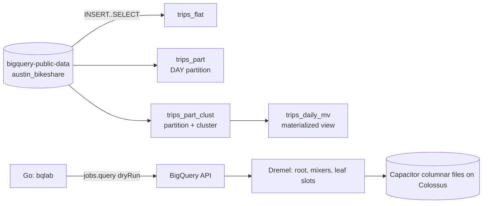

# 08 – BigQuery internals

> **Cloud behaviors are NOT yet verified against real GCP.** Terraform was only `fmt`/`validate`d and the Go code only unit-tested offline (including against a fake HTTP server). Anything marked *requires GCP* is untested; confirm numbers yourself. Pricing figures ($6.25/TiB on-demand) come from documentation and may be stale.

## Learning goals

- Dremel/Capacitor: why columnar storage makes `SELECT *` cost far more than naming columns.
- Slots and stages: a query becomes a DAG of stages run by slots (see the Execution graph in the console, or `INFORMATION_SCHEMA.JOBS`).
- How partitioning and clustering reduce **bytes scanned**.
- Dry-run cost estimation, the 10 MiB per-query minimum, MiB rounding.
- On-demand vs capacity (slot) pricing and break-even.
- Storage Write API vs legacy streaming inserts.
- Materialized views and query result caching.

## Architecture



## Prerequisites and environment

Terraform >= 1.5, Go >= 1.22, `gcloud`, optionally `bq`; a GCP project with billing and BigQuery API enabled.

```bash
export TF_VAR_project_id=your-project
export TF_VAR_region=US                 # dataset location; the public data is in US
export GCP_PROJECT_ID=$TF_VAR_project_id
export GCP_REGION=$TF_VAR_region
export GCP_ACCESS_TOKEN=$(gcloud auth print-access-token)   # for the Go tool
```

No IDs, credentials or secrets live in the repo.

## Cost estimate (unverified)

- Storage: tiny (first 10 GiB/month free).
- `bqlab load`: 3 INSERT..SELECT queries over a public table, each limited to 200k rows; likely well under 1 GiB scanned each, within the 1 TiB/month free on-demand tier.
- `compare` / `dryrun`: free (dry runs are not billed).
- Materialized view: small storage + refresh query cost.
- No slot reservations are created (they bill per slot-hour).

## Run steps

Offline:

```bash
cd go && go test ./... && go run ./cmd/bqlab predict
cd ../terraform && terraform init -backend=false && terraform validate
```

*Requires GCP:*

```bash
cd terraform && terraform init && terraform apply
cd ../go
go run ./cmd/bqlab load
go run ./cmd/bqlab compare
go run ./cmd/bqlab dryrun "SELECT duration_minutes FROM \`$GCP_PROJECT_ID.bq_internals_lab.trips_flat\`"
```

## Predict then verify

Write your answer before opening the details.

### 1. Predict the bytes billed (tiny result)
A query's dry run reports `totalBytesProcessed = 3,200,000` (about 3.05 MiB). How many bytes are billed on-demand? And for 10 MiB + 1 byte?
<details><summary>Answer</summary>
10 MiB (10,485,760) for the first: the minimum is 10 MiB. The second rounds up to the next MiB: 11 MiB. Verify offline: `cd go && go test ./internal/cost -run BilledBytes -v`. Verify on GCP: compare `total_bytes_processed` vs `total_bytes_billed` in `INFORMATION_SCHEMA.JOBS_BY_PROJECT`.
</details>

### 2. Predict the bytes billed (SELECT * vs one column)
Is `SELECT duration_minutes` about 1/7 of `SELECT *` on the 7-column `trips_flat`?
<details><summary>Answer</summary>
No. Cost is per column's stored bytes, not column count; an INT64 is ~8 bytes/row while strings are length-dependent, so the single INT64 column is much smaller than 1/7. Verify (*requires GCP*): rows 1 and 2 of `bqlab compare`. Note that with only ~200k rows both may hit the 10 MiB floor in *billed* bytes; compare the *processed* column.
</details>

### 3. LIMIT
Does `SELECT * ... LIMIT 10` scan less than `SELECT *` on `trips_flat`?
<details><summary>Answer</summary>
No; LIMIT limits output, not scan, on an unclustered table. Verify: scenarios 1 and 6 in `compare` show equal processed bytes.
</details>

### 4. Partition pruning
Filter `start_time` to one month: flat vs partitioned?
<details><summary>Answer</summary>
Flat reads the whole column; partitioned reads only the matching daily partitions. Verify: scenarios 3 vs 4 (*requires GCP*). The sample date range depends on what the 200k-row LIMIT pulled, so the month may be empty; adjust dates in `internal/queries/queries.go` if so.
</details>

### 5. Clustering
Is the dry-run estimate exact for a filter on a clustered column?
<details><summary>Answer</summary>
It is an upper bound; block pruning happens at execution. Actual `total_bytes_billed` can be lower. Verify: run the query for real, then inspect `INFORMATION_SCHEMA.JOBS_BY_PROJECT`.
</details>

### 6. Result cache
Run an identical query twice; what is billed the second time?
<details><summary>Answer</summary>
Zero bytes (cache hit, ~24h, deterministic query, unchanged tables). `CURRENT_TIMESTAMP()` and similar disable caching. Verify: `cache_hit` in `INFORMATION_SCHEMA.JOBS`, or `bqlab dryrun` reporting a cache hit.
</details>

## Break it on purpose

1. Filter with `CAST(start_time AS STRING) LIKE '2017-01%'` on `trips_part` and dry-run: pruning is lost.
2. Filter only on `start_station_id` (second cluster key) on `trips_part_clust`: pruning is weaker than filtering on the first key.
3. Add `CURRENT_TIMESTAMP()` to a query and rerun twice: cache disabled.
4. Set `deletion_protection = true` on a table, apply, then `terraform destroy`: it errors (then revert).
5. Run `compare` with an invalid `GCP_ACCESS_TOKEN`: the tool surfaces a 401.
6. Set `TF_VAR_region=EU` and run `load`: INSERT from a US public table fails with a location mismatch.
7. Query the base table with a shape that doesn't match the MV definition: the optimizer will not rewrite it to the MV.

## Under the hood

**Dremel?** Execution engine: a tree (root, mixers, leaf slots) fanning a query over storage. Query plan stages map to this DAG; inter-stage data moves through a separate shuffle tier.

**Capacitor?** BigQuery's columnar format on Colossus. Each column is stored and compressed separately, which is why only referenced columns are billed.

**Slot?** A unit of compute (CPU/memory/IO) for Dremel. On-demand shares a large pool with per-project caps; capacity pricing (editions) reserves/autoscales slots for predictable cost. Break-even: `cost.BreakEvenTiBPerMonth(monthlyUSD)` = monthly capacity cost / $-per-TiB.

**Storage Write API vs streaming inserts?** `tabledata.insertAll` is the legacy path with best-effort dedup via `insertId`. The Storage Write API uses gRPC streams with offsets (exactly-once in committed mode), pending streams for batch, and a default stream; it is cheaper. *This lab's Go tool does not implement it* (stdlib-only by design); try `cloud.google.com/go/bigquery/storage/managedwriter` on your own.

**Materialized views?** Precomputed, incrementally refreshed aggregates; the optimizer can rewrite matching queries on the base table and merge MV data with base-table deltas for freshness. Only a restricted SQL subset is allowed.

**Why is a clustered dry run only an estimate?** Block-level pruning uses runtime metadata.

## Teardown

```bash
./scripts/teardown.sh      # requires GCP: terraform destroy + dataset orphan check
```

`delete_contents_on_destroy = true` removes the dataset even with data loaded. Delete any reservations or commitments you created by hand.

## Layout

```
terraform/   versions.tf variables.tf main.tf outputs.tf
go/          cmd/bqlab, internal/{cost,bq,queries} (stdlib only, unit tested)
scripts/     teardown.sh
```
