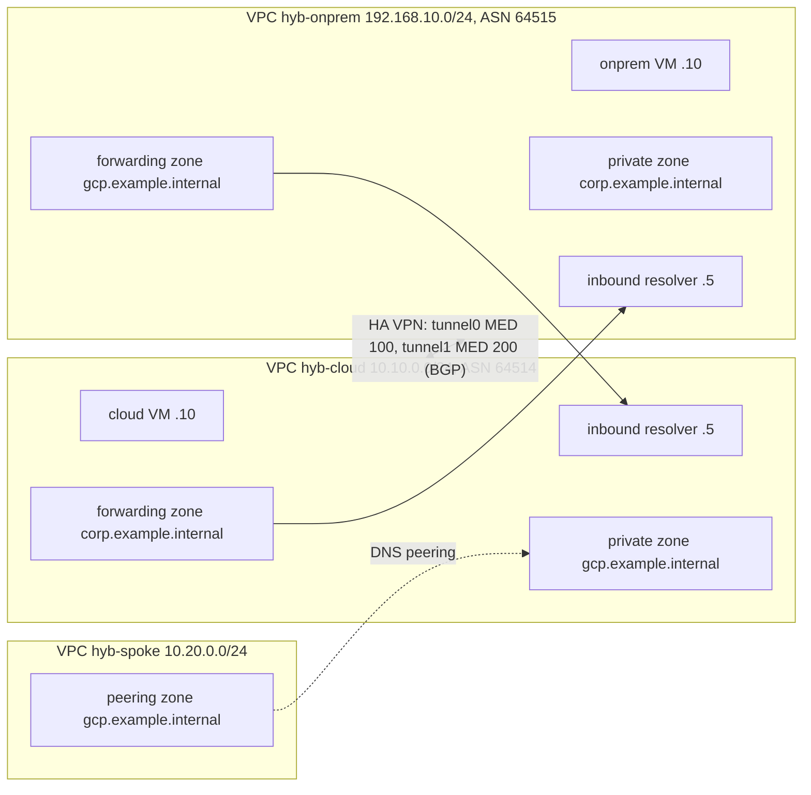

# 13 – Hybrid networking & DNS

> **Status:** Terraform and Go pass local static checks and unit tests. **Cloud behaviors described here have NOT yet been verified against real GCP.** Expect to adjust details (e.g. DNS resolver address reservation, BGP convergence time).

"On-prem" is simulated by a second VPC (`hyb-onprem`) joined to `hyb-cloud` by HA VPN + BGP. No hardware needed.

## Learning goals
- Cloud DNS private zones, forwarding zones, DNS peering, inbound server policy (and why outbound policy is a trap).
- Split-horizon DNS: one name, different answers per VPC.
- HA VPN (2 tunnels per gateway) with BGP via Cloud Router; custom route advertisement.
- MED / advertised route priority for active-passive tunnels.
- Dynamic routing mode REGIONAL vs GLOBAL.

## Architecture


## Prerequisites & env vars
terraform >= 1.5, Go >= 1.22, gcloud (cloud steps), billing-enabled project.
```bash
export GCP_PROJECT_ID=my-project GCP_REGION=us-central1
export TF_VAR_project_id=$GCP_PROJECT_ID TF_VAR_region=$GCP_REGION
```
Nothing secret is committed. VPN shared secrets come from Terraform `random_password` and are never output (they do live in state – protect it).

## Cost estimate (unverified)
HA VPN: 4 tunnels ≈ $0.075/h each ≈ $0.30/h (~$7/day); 2 e2-micro VMs a few cents/h; Cloud DNS ~$0.20/zone/month (prorated). Run an hour or two, then tear down.

## Run steps
Local (no GCP needed):
```bash
cd go && gofmt -l . && go vet ./... && go test ./... && go build -o dnsprobe .
cd ../terraform && terraform fmt -check -recursive && terraform init -backend=false && terraform validate
```
**Requires GCP:**
```bash
cd terraform && terraform init && terraform apply
gcloud compute routers get-status hyb-cloud-rtr --region $GCP_REGION
cd ../go && GOOS=linux GOARCH=amd64 go build -o dnsprobe .
Z=${GCP_REGION}-a
gcloud compute scp dnsprobe hyb-onprem-vm:~ --zone $Z --tunnel-through-iap
gcloud compute scp dnsprobe hyb-cloud-vm:~ --zone $Z --tunnel-through-iap
gcloud compute ssh hyb-onprem-vm --zone $Z --tunnel-through-iap -- ./dnsprobe -name app.gcp.example.internal
```
VMs have no external IP; IAP SSH is allowed by the firewall rules. The probe flags: `-resolver IP[:port] -name HOST -http URL -timeout 3s`.

## Predict then verify
**1. What does `www.split.example.internal` return on the cloud VM vs the onprem VM?**
<details><summary>Answer</summary>Cloud VM: 10.10.0.10; onprem VM: 192.168.10.10. Each VPC has its own private zone of the same name (split horizon).<br>Verify (requires GCP): run `./dnsprobe -name www.split.example.internal` on each VM.</details>

**2. Can the onprem VM resolve `app.gcp.example.internal`, and via what path?**
<details><summary>Answer</summary>Yes: onprem forwarding zone → cloud inbound resolver 10.10.0.5, over the VPN (private forwarding path).<br>Verify: `./dnsprobe -name app.gcp.example.internal` and `-resolver 10.10.0.5`; `gcloud dns managed-zones describe hyb-onprem-fwd-gcp`.</details>

**3. Tunnel 0 has MED 100, tunnel 1 MED 200. Which carries traffic?**
<details><summary>Answer</summary>Tunnel 0 (lower MED wins); tunnel 1 is standby. Equal MEDs give ECMP.<br>Verify: `gcloud compute routers get-status hyb-onprem-rtr --region $GCP_REGION --format="yaml(result.bestRoutes)"`.</details>

**4. The spoke VPC has no VPN or VPC peering. Can it resolve `app.gcp.example.internal`? Reach the IP?**
<details><summary>Answer</summary>It resolves (DNS peering is control-plane only) but cannot reach 10.10.0.10 – no network path exists.<br>Verify: `gcloud dns managed-zones describe hyb-spoke-peer-gcp`; to test live, add a VM in the spoke subnet.</details>

**5. Does onprem learn `10.99.0.0/24`, a custom advertised range that matches no subnet?**
<details><summary>Answer</summary>Yes – CUSTOM advertise mode announces arbitrary prefixes.<br>Verify: `gcloud compute routes list --filter="network~hyb-onprem"` shows a BGP-learned route.</details>

**6. With the cloud VPC REGIONAL, are routes learned from onprem usable in other regions?**
<details><summary>Answer</summary>No: REGIONAL programs learned routes only in the router's region; GLOBAL programs them in all regions (cross-region priority penalty applies).<br>Verify: add a subnet+VM in another region and compare `gcloud compute routes list`.</details>

## Break it on purpose
1. **Block DNS forwarders:** delete firewall `hyb-onprem-allow-dns-fwd`. Expect cloud→corp lookups to time out (source 35.199.192.0/19 blocked).
2. **Flip MEDs:** `terraform apply -var tunnel1_med=300`; best route moves to tunnel 1 (watch `get-status`).
3. **Kill a tunnel:** `gcloud compute vpn-tunnels delete hyb-c2o-0 --region $GCP_REGION`; BGP drops and traffic shifts to the other tunnel. Re-apply to restore.
4. **Mismatched secret:** make both tunnels of one side use `random_password.vpn[0]` only. The tunnel never establishes.
5. **Overlapping CIDR:** `-var onprem_cidr=10.10.0.0/24` – subnet routes beat dynamic routes, so cross-VPC traffic never leaves; BGP learned prefix is ignored.
6. **Outbound policy trap:** add `alternative_name_server_config` to a policy; it sends all non-metadata queries to that server, bypassing the VPC's private zones.
7. **Routing mode:** switch `cloud_routing_mode` and re-check learned routes from another region.

## Under the hood
- **Why `forwarding_path = "private"`?** Default routing for RFC1918 targets is already private, but explicit "private" always uses the VPC path (VPN) and fails rather than falling back to internet.
- **What is 35.199.192.0/19?** Source range of Cloud DNS forwarding queries. Real on-prem firewalls must allow it and have a route back (advertise it from Cloud Router with custom advertisement).
- **Inbound policy:** creates resolver IPs per subnet that on-prem hosts query; here reserved explicitly via `purpose = DNS_RESOLVER` so Terraform knows the IP.
- **Peering vs forwarding:** peering stays in Google's control plane and uses the target VPC's resolution order; forwarding sends real packets to a name server. Peering is not transitive.
- **MED:** `advertised_route_priority` is sent as MED; lower is preferred. Set it on both ends to keep paths symmetric.
- **ASNs 64514/64515:** private ASNs; each side needs a distinct one. BGP link-local /30s come from 169.254.0.0/16.

## Teardown
```bash
./scripts/teardown.sh   # requires GCP: terraform destroy, then orphan checks
```
