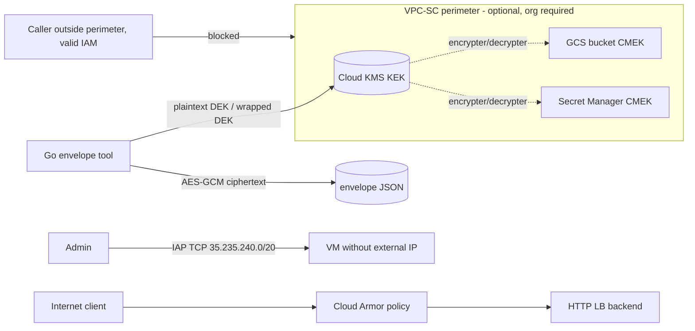

# 14 — Security Perimeter: KMS/CMEK, Secret Manager, VPC-SC, Cloud Armor, IAP

> **Verification status:** Terraform (`fmt`, `validate`) and Go (`gofmt`, `vet`, `test`) checks pass locally.
> **Cloud behaviors described here have NOT yet been verified against real GCP.** Treat every "requires GCP" step and every `<details>` answer as unverified until you run it. VPC-SC in particular needs an organization and was never exercised.

## Learning goals
- Envelope encryption: DEK (data key, local, AES-256-GCM) vs KEK (Cloud KMS key that wraps the DEK).
- Key rotation (new primary version; old versions still decrypt) and key destruction (`DESTROY_SCHEDULED`, then `DESTROYED`).
- CMEK: how Storage and Secret Manager use your KEK via service agents.
- Secret Manager versions, access, and disable/destroy.
- VPC Service Controls: dry-run vs enforced, access levels, and the exfiltration path a perimeter blocks.
- Cloud Armor policy rule evaluation; IAP TCP forwarding.

## Architecture

(Cloud Armor policy is created standalone; attaching it needs a backend service from project 03.)

## Prerequisites / env vars
- terraform >= 1.5, Go >= 1.22, gcloud (cloud steps).
- `TF_VAR_project_id` (documented alias `GCP_PROJECT_ID`) and `TF_VAR_region` (alias `GCP_REGION`):
```bash
export GCP_PROJECT_ID=my-project GCP_REGION=us-central1
export TF_VAR_project_id=$GCP_PROJECT_ID TF_VAR_region=$GCP_REGION
```
- Nothing is hardcoded; no credentials in the repo.
- **VPC-SC requires a GCP organization** and an Access Context Manager policy. It is OFF by default (`enable_vpc_sc=false`). To enable: `-var enable_vpc_sc=true -var access_policy_id=<ID> -var 'vpc_sc_allowed_members=["user:you@example.com"]'`, plus org-level permissions (Access Context Manager Admin). `vpc_sc_enforced=false` (default) = dry-run.

## Cost estimate (unverified)
Roughly < $1 for a short session: KMS key version ~$0.06/month, Secret Manager version ~$0.06/month, tiny bucket, Cloud Armor policy ~$5/month prorated (+ per-rule), firewall/VPC free. VPC-SC itself is free. Destroy when done.

## Run steps
**Local (no GCP):**
```bash
cd go && gofmt -l . && go vet ./... && go test ./...
cd ../terraform && terraform fmt -check -recursive && terraform init -backend=false && terraform validate
```
**Requires GCP:**
```bash
cd terraform && terraform init && terraform plan && terraform apply   # requires GCP
KEK=$(terraform output -raw kek_id)
export GCP_ACCESS_TOKEN=$(gcloud auth print-access-token)
cd ../go && echo "top secret" > /tmp/plain.txt
go run . -key "$KEK" -in /tmp/plain.txt -out /tmp/env.json -aad demo seal     # requires GCP
go run . -key "$KEK" -in /tmp/env.json -aad demo open                         # requires GCP
```
Your identity needs `roles/cloudkms.cryptoKeyEncrypterDecrypter` on the key to run the tool (grant it with `gcloud kms keys add-iam-policy-binding`).

## Predict then verify
**1. You rotate the KEK, then open an envelope sealed before rotation. Does it work?**
<details><summary>Answer</summary>Yes. Rotation adds a new primary version; KMS ciphertext embeds the version, and old (ENABLED) versions still decrypt. Verify: `gcloud kms keys versions create --key secperim-kek --keyring secperim-ring --location $GCP_REGION --primary` then rerun `open`. (Unit test `TestRotationAndRewrap` models this with a fake.)</details>

**2. After rotation, does `rewrap` re-encrypt the data?**
<details><summary>Answer</summary>No — only the 32-byte DEK is re-wrapped; the data ciphertext is byte-identical. That is the point of envelope encryption. Verify: compare `ciphertext` fields in env.json vs env2.json after `rewrap`; `wrapped_dek` differs.</details>

**3. You destroy the key version used by the envelope. What happens to `open` immediately, and after 24h?**
<details><summary>Answer</summary>Immediately: version goes to DESTROY_SCHEDULED and decrypt fails (FAILED_PRECONDITION). It can be restored within the window; after the window it is DESTROYED and the data is cryptographically erased. Verify: `gcloud kms keys versions destroy 1 ...`, then `open`; `gcloud kms keys versions restore 1 ...`.</details>

**4. You add a new Secret Manager version and disable v1. What does `latest` return?**
<details><summary>Answer</summary>`latest` resolves to the newest ENABLED version. Accessing a disabled version explicitly errors. Verify: `echo -n v2 | gcloud secrets versions add secperim-demo --data-file=-`; `gcloud secrets versions access latest --secret secperim-demo`; `gcloud secrets versions disable 1 --secret secperim-demo`; access `1`.</details>

**5. A user with full IAM on the bucket, outside the perimeter, runs `gsutil cat`. Dry-run vs enforced?**
<details><summary>Answer</summary>Dry-run: the read succeeds, but a VPC_SERVICE_CONTROLS violation audit log is written. Enforced: 403 "Request is prohibited by organization's policy" with a vpcServiceControlsUniqueIdentifier. Verify: `gcloud storage cat gs://BUCKET/obj`, then `gcloud logging read 'protoPayload.metadata.@type="type.googleapis.com/google.cloud.audit.VpcServiceControlAuditMetadata"' --limit 5`. Requires an org.</details>

**6. A Cloud Armor rule at priority 1000 denies 198.51.100.0/24 and the default rule (2147483647) allows all. Which wins for 198.51.100.7?**
<details><summary>Answer</summary>Lowest priority number evaluated first; first match wins → deny(403). Verify (needs an LB with the policy attached): `curl` from that range, or `gcloud compute security-policies rules describe 1000 --security-policy secperim-armor`.</details>

## Break it on purpose
1. **Remove the Storage agent's KMS grant** (`terraform state rm google_kms_crypto_key_iam_member.gcs_agent` then delete the binding in console) and upload an object → expect a 403 about cloudkms permission. Re-apply to fix.
2. **Wrong AAD**: `open -aad wrong` → KMS decrypt fails. AAD binds a wrapped DEK to its context.
3. **Flip a byte** in `ciphertext` of env.json → AES-GCM auth failure ("decrypt data") even though KMS unwrap succeeds.
4. **Disable the key version** while the secret uses CMEK, then access the secret → access fails until re-enabled.
5. **Enforce the perimeter** (`-var vpc_sc_enforced=true`) with an empty `vpc_sc_allowed_members` → you lock yourself out of storage/KMS APIs; recover via org admin editing the perimeter. (Requires org; unverified.)
6. **Set `armor_blocked_cidrs` to `["0.0.0.0/0"]`** with an attached LB → all traffic 403s.

## Under the hood
- **Why not send data to KMS?** Encrypt has a 64 KiB payload limit and adds a network hop per byte; envelope encryption sends only 32 bytes.
- **Who is the KEK's principal for CMEK?** Per-service service agents (e.g. `service-<num>@gcp-sa-secretmanager...`), not you. They need `cryptoKeyEncrypterDecrypter`.
- **Can key rings/keys be deleted?** No. Only versions. Hence names are reserved forever and Terraform destroy only removes state + schedules version destruction.
- **`destroy_scheduled_duration`** is immutable after key creation (default 30 days if unset; we use 24h, the minimum, for cheap iteration).
- **VPC-SC vs IAM:** IAM answers "who"; VPC-SC answers "from where/what context" at the API layer, independent of IAM grants. It stops a stolen credential or insider copying data to a project outside the perimeter (e.g. `gcloud storage cp` to an external bucket).
- **Dry-run in Terraform** uses the `spec` block with `use_explicit_dry_run_spec = true`; enforced uses `status`.
- **Cloud Armor** evaluates rules by ascending priority at Google's edge for external LBs; preconfigured WAF rules are ModSecurity CRS-based.
- **IAP TCP forwarding** tunnels from `35.235.240.0/20` to private VMs; the firewall must allow that range and the user needs `roles/iap.tunnelResourceAccessor`.

## Teardown
```bash
./scripts/teardown.sh      # requires GCP; runs terraform destroy then orphan checks
```
KMS key rings/keys remain (free); key versions are scheduled for destruction. If you enabled VPC-SC, confirm the perimeter was removed (org-level).
