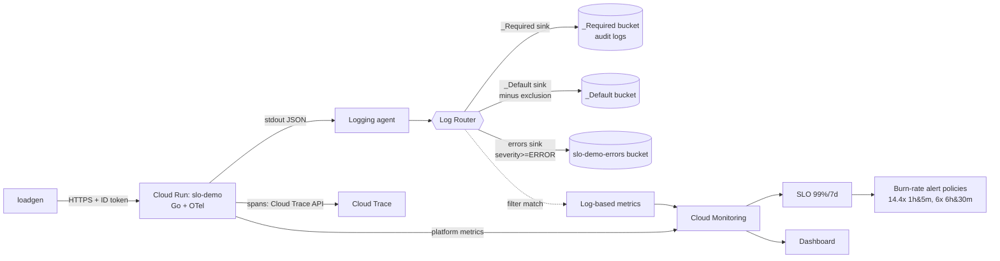

# 15 — Observability & SLOs on GCP

> **Status: NOT yet verified against real GCP.** Terraform passes `fmt`/`validate` and the Go code passes `vet`/unit tests locally. Nothing here has been applied. Every cloud behavior described (log routing, burn-rate alert firing, trace correlation, filter syntax accepted by the API, costs) is expected behavior from documentation — treat it as a hypothesis until you verify it. Steps that need a project are marked **(requires GCP)**.

## Learning goals

- **Cloud Logging architecture**: Log Router, sinks, exclusion filters, `_Required` vs `_Default` buckets, custom buckets, log-based metrics.
- **Cloud Monitoring**: metric types (`run.googleapis.com/request_count`, user-defined `logging.googleapis.com/user/*`), kinds (DELTA/GAUGE/CUMULATIVE), aligners/reducers, a PromQL taste.
- **SLOs & error budgets**: request-based SLI, burn rate, **multi-window multi-burn-rate** alerting.
- **Cloud Trace + OpenTelemetry**: instrument a Go service, export spans with the Google Cloud exporter, correlate logs and traces via structured JSON fields.

## Architecture



## Prerequisites & env vars

- A GCP project with billing, `gcloud`, Terraform ≥ 1.5, Go (see `go/go.mod`), Docker (or Cloud Build).
- Config is env-only; nothing is hardcoded:

```bash
export GCP_PROJECT_ID=<your-project>   # used by the Go service and scripts
export GCP_REGION=us-central1
export TF_VAR_project_id=$GCP_PROJECT_ID
export TF_VAR_region=$GCP_REGION
```

Optional: `TF_VAR_notification_email`, `TF_VAR_image`, `TF_VAR_fault_error_rate`, `TF_VAR_fault_latency_ms`.

## Cost estimate (unverified)

Expected to be small for a short lab: Cloud Run scales to zero (cents for minutes of traffic); Logging has a free monthly ingestion allotment per project (50 GiB at time of writing — check current pricing), Monitoring metrics from GCP services are free, user-defined log-based metrics are generally billed as custom metrics beyond free tier; Trace has a free span allotment. Dashboards, SLOs, alert policies are free. Expect **well under a few USD** for a 1–2 hour lab if you run `teardown.sh`. Verify in Billing reports.

## Run steps

### Local (no GCP needed)

```bash
cd go && go vet ./... && go test ./...
OTEL_DISABLED=true GCP_PROJECT_ID=demo FAULT_ERROR_RATE=0.2 go run . &
curl -s localhost:8080/work            # JSON log lines show trace fields
curl -s -XPOST 'localhost:8080/admin/faults?error_rate=0.5&latency_ms=200'
go run ./cmd/loadgen -url http://localhost:8080 -rps 20 -duration 20s
```

### Cloud **(requires GCP)**

```bash
# 1. Create infra with the placeholder image first (needs Artifact Registry repo for your own image; create one manually or via your own Terraform)
cd terraform && terraform init && terraform apply     # review plan yourself

# 2. Build and push the Go image (example using Cloud Build; adjust repo)
IMG=$GCP_REGION-docker.pkg.dev/$GCP_PROJECT_ID/<repo>/slo-demo:v1
gcloud builds submit ../go --tag "$IMG" --project $GCP_PROJECT_ID
TF_VAR_image=$IMG terraform apply

# 3. Healthy traffic
URL=$(terraform output -raw service_url)
TOKEN=$(gcloud auth print-identity-token)
TOKEN=$TOKEN go run ../go/cmd/loadgen -url $URL -rps 20 -duration 10m

# 4. Breach the SLO
curl -s -XPOST -H "Authorization: Bearer $TOKEN" "$URL/admin/faults?error_rate=0.3"
TOKEN=$TOKEN go run ../go/cmd/loadgen -url $URL -rps 20 -duration 20m
```

Note: this project does not create an Artifact Registry repo (to keep scope on observability); you must provide one. `/admin/faults` state is per-instance and lost on cold start — use `TF_VAR_fault_error_rate` for a persistent fault.

## Predict then verify

**1. A burn rate of 1.0 means what?**
<details><summary>Answer</summary>The error budget is consumed exactly at the rate that exhausts it at the end of the SLO window. With a 99% goal, burn rate = error ratio / 0.01, so a 1% error ratio = burn 1; 30% errors = burn 30.</details>

Verify **(requires GCP)**: with `error_rate=0.3`, open Monitoring → Services → slo-demo and read the burn rate; or query `select_slo_burn_rate` in Metrics Explorer (MQL/filter).

**2. With the 14.4x/1h AND 5m alert, you start 30% errors. Roughly when does it fire, and why is the 5m window there?**
<details><summary>Answer</summary>Burn is ~30 right away on the 5m window, but the 1h window must average >14.4, i.e. roughly 48% of an hour at burn 30 → ~29 minutes of steady 30% errors. The 5m window makes the alert reset quickly after the problem stops instead of staying red for up to an hour.</details>

Verify **(requires GCP)**: note the time you inject faults, and compare with the incident's start time on the alert policy.

**3. Do `/healthz` request logs appear in the `_Default` bucket after the exclusion is applied?**
<details><summary>Answer</summary>No, matching entries are dropped from `_Default` storage. (They're also not stored in the custom bucket since that sink's filter is severity>=ERROR.) Cloud Run's *platform request logs* are what carry `httpRequest.requestUrl`; the app's own logs do not log healthz.</details>

Verify **(requires GCP)**: `gcloud logging read 'httpRequest.requestUrl:"/healthz"' --limit 5 --freshness 10m`.

**4. An ERROR log from the service: in how many buckets does it land?**
<details><summary>Answer</summary>Expected two: `_Default` (its sink has no severity restriction) and `slo-demo-errors`. Sinks are evaluated independently; a match in one does not stop the others. It does not go to `_Required` (audit-only).</details>

Verify **(requires GCP)**: `gcloud logging read 'jsonPayload.event="injected_error"' --bucket=slo-demo-errors --location=global --view=_AllLogs --limit 3`, then repeat with `--bucket=_Default`.

**5. Does the `slo_demo_injected_errors` log metric increase for a log excluded from `_Default`?**
<details><summary>Answer</summary>Unsure — the documentation should be consulted; my expectation is that log-based metrics are evaluated as logs are received by the router, independent of storage exclusions, but this is unverified. Run the experiment.</details>

Verify **(requires GCP)**: add `jsonPayload.event="injected_error"` to the exclusion filter temporarily, generate errors, and watch the metric in Metrics Explorer.

**6. What fields make a log line link to its trace in Logs Explorer?**
<details><summary>Answer</summary>`logging.googleapis.com/trace` = `projects/PROJECT/traces/TRACE_ID`, plus `logging.googleapis.com/spanId` and `logging.googleapis.com/trace_sampled`. The agent lifts them out of `jsonPayload` into LogEntry fields.</details>

Verify: locally, `curl localhost:8080/work` and inspect the JSON line; unit test `TestLogHasTraceCorrelation`. In cloud, open a log entry → "View trace details".

## Break it on purpose

1. **Remove `roles/cloudtrace.agent`** (delete the IAM member, apply). Expect: service works, spans vanish, exporter errors in service logs. Restore.
2. **Change the sink filter to a typo** (`severity>=ERRORS`). Expect: the API rejects it or the bucket stays empty; observe how you'd detect a silently empty sink.
3. **Set `slo_goal = 0.999`** with 30% errors. Expect burn rate ~300; alerts fire sooner, and the 14.4 threshold is far exceeded.
4. **Drop the short window** (delete the 5m condition from `fast_burn`). Expect the alert to stay open well after you set `error_rate=0` — flapping/long-reset behavior.
5. **Inject latency only** (`latency_ms=3000`, error 0). Expect the availability SLO is *unaffected* (it only counts 5xx); the p95 dashboard tile rises. Lesson: an SLI must express what users care about; add a latency SLO to catch this.
6. **Exclude everything** (`filter = "resource.type=\"cloud_run_revision\""` on the exclusion). Expect `_Default` empty for this service, the errors bucket still populated (separate sink).

## Under the hood

**Q: What are `_Required` and `_Default`?**
Two built-in buckets with built-in sinks. `_Required` holds admin-activity/system-event audit logs, 400-day retention, cannot be changed or excluded. `_Default` takes everything else, 30-day default retention, its sink's exclusions are editable.

**Q: Exclusion vs. sink filter?**
Sink filter selects what goes in; exclusion filters subtract from a sink. Exclusions are per-sink (the `google_logging_project_exclusion` resource attaches to `_Default`).

**Q: Why a *log-based metric* rather than a platform metric?**
Platform metrics (request_count) cover infrastructure-visible facts. Log-based metrics extract app-specific signals (a field in `jsonPayload`) with counter or distribution semantics, labels via extractors.

**Q: MQL vs PromQL?**
MQL is Cloud Monitoring's own pipeline language and is being deprecated in favour of PromQL for new work (check current status). The dashboard here uses PromQL; names map `run.googleapis.com/request_count` → `run_googleapis_com:request_count`.

**Q: Why multi-window?**
Long window gives significance (not a blip); short window proves it's still happening. Burn thresholds 14.4/6 come from the Google SRE Workbook (2%/1h and 5%/6h of a 30-day budget).

**Q: How does trace context arrive?**
The incoming `traceparent` header is extracted by the W3C propagator in `Handler()`; the span context is carried through `context.Context` to the logger, which stamps trace IDs.

**Q: Why is the SLI based on `request_count` with response_code_class and not on logs?**
Metrics are cheap, regular, and complete; log sampling/exclusions could silently distort an SLI.

## Teardown

```bash
./scripts/teardown.sh     # requires GCP; destroys, then checks for orphans
```

Custom log buckets are soft-deleted (~7 days) — expected. APIs are left enabled (`disable_on_destroy = false`). Remove any Artifact Registry repo/images you created yourself.

## Layout

```
terraform/  versions.tf variables.tf main.tf outputs.tf
go/         main.go server.go logging.go telemetry.go *_test.go cmd/loadgen Dockerfile
scripts/    teardown.sh
```
