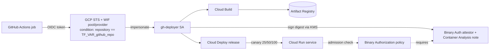

# 16 – CI/CD & Supply Chain on Cloud Run

> **Verification status:** Terraform is validated (`fmt`/`validate`) and Go code is unit-tested locally only. **Cloud behaviors described here have NOT yet been verified against real GCP.** Treat every "requires GCP" step and every answer below as expected behavior to confirm yourself.

## Learning goals
- Deploy from GitHub Actions **without service-account keys** using Workload Identity Federation (WIF), pinned to one repo.
- Understand what an image **digest** is and why Binary Authorization attestations bind to it, not tags.
- Gate Cloud Run on **Binary Authorization** attestations (KMS-signed).
- Roll out with **Cloud Deploy** canary (25% → 50% → 100%) across Cloud Run revisions; roll back.
- Use **revision tags** and manual **traffic splitting**.

## Architecture



## Layout
`terraform/` (all infra) · `go/` (service, `cmd/verifier`, `internal/supply`, Dockerfile) · `cloudbuild.yaml` · `clouddeploy/` (skaffold + service manifest) · `docs/example-workflow.yml` (example only, deliberately not in `.github/`) · `scripts/teardown.sh`.

## Prerequisites & env vars
Terraform ≥ 1.5 (tested 1.16), Go ≥ 1.22, `gcloud` (cloud steps), a GCP project with billing, a GitHub repo.

```bash
export TF_VAR_project_id="my-project"      # also GCP_PROJECT_ID
export TF_VAR_region="us-central1"         # also GCP_REGION
export TF_VAR_github_repo="OWNER/REPO"     # the only repo WIF will trust
export GCP_PROJECT_ID=$TF_VAR_project_id GCP_REGION=$TF_VAR_region
```
No IDs, credentials or secrets are in the code.

## Cost estimate (unverified)
Mostly pennies: Artifact Registry storage (~$0.10/GB-mo), Cloud Build (120 free min/day), Cloud Run scale-to-zero, Cloud Deploy (first pipeline free tier; check current pricing), KMS key ≈ $0.06/mo plus per-sign ops, Binary Authorization (check current pricing). Expect < $1 for a short session; tear down after.

## Run steps
Local (no GCP needed):
```bash
cd go && gofmt -l . && go vet ./... && go test ./...
cd ../terraform && terraform fmt -check -recursive && terraform init -backend=false && terraform validate
```
Requires GCP:
1. `cd terraform && terraform init && terraform apply` (requires GCP). Note outputs `wif_provider`, `deployer_service_account`, `artifact_registry_repo`.
2. Build & push (requires GCP):
   `gcloud builds submit . --config cloudbuild.yaml --substitutions=_REPO=$GCP_REGION-docker.pkg.dev/$GCP_PROJECT_ID/supply-chain,_TAG=v1`
3. Resolve digest (requires GCP):
   `IMAGE=$GCP_REGION-docker.pkg.dev/$GCP_PROJECT_ID/supply-chain/app@$(gcloud artifacts docker images describe $GCP_REGION-docker.pkg.dev/$GCP_PROJECT_ID/supply-chain/app:v1 --format='get(image_summary.digest)')`
4. Check it locally: `cd go && go run ./cmd/verifier -image "$IMAGE" -emit`
5. Attest (requires GCP): see the "Attest" step in `docs/example-workflow.yml`.
6. Release (requires GCP): `gcloud deploy releases create rel-1 --delivery-pipeline=supply-chain-pipeline --region=$GCP_REGION --source=clouddeploy --images=app=$IMAGE`, then promote/advance the canary phases in the console or `gcloud deploy rollouts advance`.
7. CI: copy `docs/example-workflow.yml` into your repo's `.github/workflows/` and set repo variables `GCP_PROJECT_ID`, `GCP_REGION`, `WIF_PROVIDER`, `DEPLOYER_SA`.

Binary Authorization starts in `DRYRUN_AUDIT_LOG_ONLY`. Switch with `-var binauthz_enforcement_mode=ENFORCED_BLOCK_AND_AUDIT_LOG` to block.

## Predict then verify

**1. A workflow in `OTHER/REPO` presents a valid GitHub OIDC token to your provider. What happens?**
<details><summary>Answer</summary>STS rejects the exchange: the provider `attribute_condition` (`assertion.repository == "<your repo>"`) fails before any IAM binding is evaluated. Even without the condition, the `principalSet` binding on `attribute.repository/<repo>` would not match, but the condition is the first gate.</details>

Verify (requires GCP): `terraform output wif_provider`, then `gcloud iam workload-identity-pools providers describe github-oidc --workload-identity-pool=github-pool --location=global --format='value(attributeCondition)'`.

**2. Two pushes of tag `v1` produce different content. Which does an attestation made earlier cover?**
<details><summary>Answer</summary>Only the digest it was created for. Tags are mutable pointers; attestations sign the digest. Hence the verifier rejects tag references.</details>

Verify: `cd go && go run ./cmd/verifier -image us-docker.pkg.dev/p/r/app:v1; echo $?` → FAIL, exit 1.

**3. Cloud Deploy canary is at 25%. What do requests see?**
<details><summary>Answer</summary>Roughly 25% of requests go to the new revision, 75% to the previous; JSON `revision` field differs between responses.</details>

Verify (requires GCP): `for i in $(seq 40); do curl -s $(terraform -chdir=terraform output -raw cloud_run_url) ; echo; done | sort | uniq -c`.

**4. Policy is ENFORCED and you deploy an unattested digest. Outcome?**
<details><summary>Answer</summary>Revision creation fails with a Binary Authorization denial; the service keeps serving the previous revision.</details>

Verify (requires GCP): `gcloud run deploy supply-chain-demo --image=<unattested digest ref> --region=$GCP_REGION`.

**5. You ask for traffic 70/25. What happens?**
<details><summary>Answer</summary>Cloud Run requires percents to sum to 100; the request is rejected. Locally `ValidateSplits` models this.</details>

Verify: `cd go && go test ./internal/supply -run Splits -v`.

**6. After a release finishes, why doesn't `terraform plan` try to revert the service image?**
<details><summary>Answer</summary>`lifecycle.ignore_changes` on `template`/`traffic` hands ownership of revisions to Cloud Deploy.</details>

Verify: read the `google_cloud_run_v2_service.app` lifecycle block in `terraform/main.tf`.

## Break it on purpose
1. **Wrong repo:** apply with `TF_VAR_github_repo=someone/else`; your real workflow's auth step should fail with an STS/“unable to acquire impersonated credentials” error (requires GCP).
2. **Drop `id-token: write`** from the workflow permissions; auth action fails because no OIDC token can be requested.
3. **Tag instead of digest:** pass `:v1` to `verifier`; observe rejection (local).
4. **Tamper payload:** `verifier -emit` output, change a hex digit in a file, run `-payload file`; mismatch error (local).
5. **Enforce without attesting:** set enforcement to `ENFORCED_BLOCK_AND_AUDIT_LOG`, deploy a fresh image with no attestation; denied (requires GCP).
6. **Remove the `ignore_changes` block** and re-apply after a release; Terraform tries to reset the revision (requires GCP).
7. **Roll back:** during a canary run `gcloud deploy rollouts cancel`/redeploy the previous release, confirm traffic returns to the old revision (requires GCP).

## Revision tags & traffic splitting (requires GCP)
```bash
gcloud run services update-traffic supply-chain-demo --region=$GCP_REGION --set-tags=candidate=<REVISION>   # URL: https://candidate---<service-url>
gcloud run services update-traffic supply-chain-demo --region=$GCP_REGION --to-revisions=<NEW>=10,<OLD>=90
gcloud run services update-traffic supply-chain-demo --region=$GCP_REGION --to-latest   # reset
```
Note: manual changes may conflict with Cloud Deploy's traffic management; use them on a scratch service or between releases.

## Under the hood
**How does keyless auth work?** GitHub issues a short-lived signed JWT per job; STS validates signature against GitHub's JWKS, applies the attribute mapping and condition, and returns a federated token that may impersonate the SA if the principalSet has `workloadIdentityUser`.

**Why `attribute.repository` and not just `sub`?** `sub` includes ref/environment; repository gives stable repo-level scoping. Tighten further by adding `&& assertion.ref == "refs/heads/main"` to the condition.

**What is signed in an attestation?** A JSON "simple signing" payload naming the repository and manifest digest (see `internal/supply`); the signature is made with the KMS key, and stored as a Container Analysis occurrence tied to the note.

**How does Cloud Deploy do a canary on Cloud Run?** Each phase creates/updates a revision and sets traffic percentages (25, 50, then 100) via the Cloud Run API; rollback restores the prior revision to 100%.

**Why whitelist the hello image?** The bootstrap image isn't attested; without the pattern, even enforced mode would block the first apply.

## Teardown
```bash
./scripts/teardown.sh   # requires GCP: terraform destroy + orphan checks
```
KMS key versions are destroyed after a 24h delay and WIF pools soft-delete for 30 days (can block reuse of the same pool ID; change the ID if re-creating soon).
